# Звіт ЛР10. Інженерний аудит документації, архітектурний паспорт (SDD, ISD, ADR) і Handover

- **Студент:** Yehor Ishchuk
- **Об'єкт:** `shop-quality`, ядро інтернет-магазину (Java 17), розвивається з ЛР1. Репозиторій: https://github.com/YehorIshchuk/shop-quality
- **Інструменти:** Git CLI, Markdown (Obsidian / VS Code), Mermaid, `tools/doc_audit.py` (обгортка над Git CLI, друкує кожну команду і її вивід)
- **Дата:** 2026-11-21

**Коміти ЛР10**

| Коміт | Повідомлення | Завдання |
|---|---|---|
| `fde6496` | `docs(audit): inventory documentation and measure currency baseline` | 1 |
| `3442925` | `docs(architecture): deliver design and infrastructure passport` | 2 |
| `447ce9f` | `docs(maintenance): establish documentation maintenance regime` | 3.1 |
| `9c67cdf` (тег `lab10-decay-fail`) | `docs(audit): simulate documentation decay, FAIL` | 3.2 |
| `c3fbea7` (тег `lab10-docs-pass`) | `docs(maintenance): restore documentation currency, PASS` | 3.3 |
| наступний | `docs(handover): knowledge transfer package and LAB10 report` | 3.4 |

> 📸 **СКРІНШОТ 1:** `git log --oneline --graph -8` у терміналі (видно всі коміти й теги ЛР10).

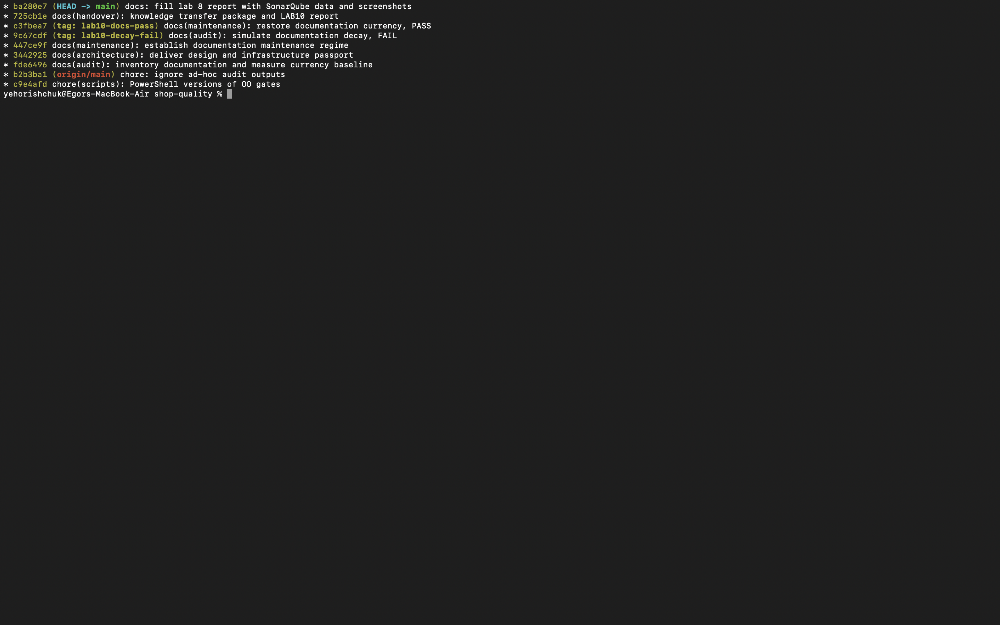

---

## Завдання 1. Інвентаризаційний аудит документації

### 1.1 Інвентаризаційний реєстр

Тип: **продукт** — «живий» документ, що еволюціонує разом із системою; **процес** — історичний запис факту в часі.

| # | Назва документа | Розташування | Тип | Категорія | Цільова аудиторія | Власник | Потреби, які **не** покриває |
|---|---|---|---|---|---|---|---|
| 1 | README | `README.md` | продукт | експлуатаційна + технічна | новачок, розробник | Yehor Ishchuk | бізнес (немає «що і для кого»), DevOps (лише Docker-шлях), онбординг |
| 2 | Інструкція розгортання і захисту | `docs/DEMO.md` | процес | експлуатаційна | QA / викладач | Yehor Ishchuk | DevOps: фактичне розгортання без Docker; новачок: призначення системи |
| 3 | Звіт ЛР1 | `docs/LAB1_REPORT.md` | процес | технічна | викладач (бізнес) | Yehor Ishchuk | поточний стан коду (описує `StoreManager`, якого вже немає) |
| 4 | Звіт ЛР8 | `docs/LAB8_REPORT.md` | процес | архітектурна | викладач, розробник | Yehor Ishchuk | QA: контракти; DevOps: нічого |
| 5 | Architecture blueprint | `docs/lab8/architecture-blueprint.md` | продукт (фактично створений як процес ЛР8) | архітектурна | розробник | Yehor Ishchuk | модель даних, API, розгортання |
| 6 | Логи краш-тестів ЛР8 | `docs/lab8/*-build.log` | процес | технічна | QA, викладач | Yehor Ishchuk | — (доказ, а не довідник) |
| 7 | Docker Compose | `docker-compose.yml` | продукт (config as doc) | експлуатаційна | DevOps | Yehor Ishchuk | macOS без Docker |
| 8 | Конфіг sonar-scanner CLI | `sonar-project.properties` | продукт | експлуатаційна | DevOps | Yehor Ishchuk | не використовується: `scan.sh` працює через Maven-плагін |
| 9 | Збірка | `pom.xml` | продукт | експлуатаційна | DevOps, розробник | Yehor Ishchuk | — |
| 10 | Залежності Python | `tools/requirements.txt` | продукт | експлуатаційна | DevOps | Yehor Ishchuk | — |
| 11 | Шапки-коментарі скриптів | `scripts/*.sh`, `*.ps1` | продукт | експлуатаційна | DevOps | Yehor Ishchuk | порядок запуску, змінні середовища зведено ніде |
| 12 | Javadoc / коментарі в коді | `src/main/java/**` | продукт | технічна | розробник | Yehor Ishchuk | зведена карта компонентів; 2 коментарі вводять в оману (див. 1.4) |
| 13 | Звіти OO-аудиту | `reports/oo/**` | процес | архітектурна | розробник, викладач | Yehor Ishchuk | — (знімки станів) |
| 14 | Повідомлення комітів | `git log` | процес | технічна | розробник | Yehor Ishchuk | — |
| 15 | Git-теги + таблиця станів | `git tag`, README | процес | експлуатаційна | QA, викладач | Yehor Ishchuk | — |
| 16 | Трекер задач | GitHub Issues | процес | — | — | — | **відсутній** (0 задач) |
| 17 | SDD / ISD / ADR | `docs/sdd.md`, `docs/isd.md`, `docs/architecture/adr/` | продукт | архітектурна / експлуатаційна | розробник, QA, DevOps | — | **відсутні**: прогалина для всіх аудиторій |

### 1.2 Лог метрик актуальності (Git CLI)

Скрипт `tools/doc_audit.py` виконує команди з методички і друкує їх разом із виводом. Повний лог:
[reports/docs/01-baseline.md](../reports/docs/01-baseline.md). Фрагмент:

```text
$ git log -1 --format=%cs -- README.md
2026-11-15
$ git log --oneline -- README.md | wc -l
2
$ git log -1 --format=%cs -- docs/DEMO.md
2026-11-15
$ git log -1 --format=%cs -- docs/sdd.md
(порожньо)
$ git log --oneline -- src/main/java/com/kira/shop/infrastructure | wc -l
4
$ git log --oneline -- scripts | wc -l
6
$ git rev-list --count 0cee12c..HEAD -- scripts
1
```

**Last Updated Age** (на 2026-11-21, пороги: > 90 дн підозрілий, > 180 дн застарілий):

| Документ | Останній коміт | Вік, дн | Статус |
|---|---|---|---|
| README.md, DEMO.md, LAB1/LAB8_REPORT, blueprint, docker-compose.yml, sonar-project.properties, pom.xml, requirements.txt, логи ЛР8 | 2026-11-15 | 6 | OK |
| docs/sdd.md, docs/isd.md, docs/architecture/adr | — | — | **MISSING** |

**Code-Doc Change Ratio** (на baseline за кожен компонент коду відповідав лише README):

| Компонент | Комітів коду : README | Комітів коду після останньої зміни README | Вердикт |
|---|---|---|---|
| domain | 1 : 2 | 0 | OK |
| application | 2 : 2 | 0 | OK |
| infrastructure | 4 : 2 | 0 | OK |
| report | 3 : 2 | 0 | OK |
| scripts | 6 : 2 | **1** (`c9e4afd` додав PowerShell-гейти після README) | BEHIND |
| tools | 2 : 2 | 0 | OK |

**Структурні перевірки** (код ↔ текст документів): 15 перевірок, провалено **15**: 7 пакетів і 5 адаптерів ніде не описані
(SDD немає), 3 змінні середовища (`SONAR_TOKEN`, `SONAR_HOST_URL`, `GATE_CLASSES`) ніде не задокументовані (ISD немає).
**DOC CURRENCY GATE: FAIL.**

**Access Evidence** (чи був документ затребуваний за останній місяць):

| Документ | Свідчення використання | Висновок |
|---|---|---|
| README.md | головна сторінка репозиторію на GitHub; з неї переходили до звітів | використовується |
| LAB1/LAB8_REPORT | здані й перевірені викладачем | використовуються (як історія) |
| DEMO.md | **не відкривався**: SonarQube налаштовано за покроковими інструкціями в чаті, бо інструкція з Docker не працювала | **Dead + Decay** |
| docker-compose.yml | не запускався (Docker Desktop недоступний) | Dead у цьому середовищі |
| sonar-project.properties | жодного запуску `sonar-scanner` CLI, `scan.sh` іде через Maven | **Dead** |
| blueprint | посилання зі звіту ЛР8 | використовується лише як історія |
| логи ЛР8 | посилання зі звіту ЛР8 і DEMO.md | процесний доказ |

**Інженерний висновок щодо метрик.** Уся історія проєкту вміщується в 6 днів, тому вік документа нічого не показав:
усе «зелене». Реальну деградацію виявили **структурні перевірки** і **змістовна звірка** документа з фактичним
середовищем. Отже, вік (Last Updated Age) — лише індикатор, а не доказ: документ може бути свіжим і вже брехати.

### 1.3 Діагноз антипатернів

**Documentation Decay** (документ описує систему, якої вже немає):
1. `README.md` → «Швидкий старт» починається з `docker compose up -d`, хоча фактичне робоче середовище — SonarQube 26.x
   з ZIP на JDK 21 через `SONAR_JAVA_PATH`. Новачок, який іде за README, зупиняється на першому кроці.
2. `docs/DEMO.md` → у §0 Docker Desktop указаний як обов'язковий, у §1 описано вхід `admin / admin` через контейнер.
3. `dto/OrderDto` → Javadoc «для експорту та API», хоча **HTTP API в системі не було**. Коментар обіцяє неіснуючу поведінку.
4. `infrastructure/FileOrderRepository` → назва й Javadoc «сховище з файлом», а дані живуть лише в пам'яті.
5. `scripts` → на 1 коміт новіші за README (PowerShell-гейти не відображені в документації).

**Dead Documentation** (документ існує, але не має споживача):
1. `sonar-project.properties`: конфігурація альтернативного сканера, яку жодного разу не використано.
2. `docs/DEMO.md`: у реальному сценарії розгортання не використовувався.
3. `docker-compose.yml`: не має споживача в поточному середовищі (але корисний для Linux/Windows).

### 1.4 Матриця вердиктів (вхідні дані для Завдання 2)

| Артефакт | Вердикт | Обґрунтування і дія (виконано в коміті `3442925`) |
|---|---|---|
| README.md | **оновити** | переписано: призначення для бізнесу, швидкий старт без Docker, онбординг, карта паспорта |
| docs/DEMO.md | **deprecated** | банер `DEPRECATED` з посиланням на README/ISD; розділи відтворення тегів лишаються як історія |
| docs/LAB1_REPORT.md, LAB8_REPORT.md | **deprecated** (архів процесу) | банер «історичний документ», зміст не переписується |
| docs/lab8/architecture-blueprint.md | **deprecated** | замінено на `docs/sdd.md`, банер із посиланням |
| docs/lab8/*.log, reports/oo/** | **deprecated** (архів) | незмінні процесні докази |
| docker-compose.yml | **оновити** | шапку позначено «альтернатива для Linux/Windows», основний шлях — ISD D4 |
| sonar-project.properties | **видалити** | Dead Documentation, `git rm` |
| Javadoc `OrderDto`, `FileOrderRepository` | **оновити** | прибрано обіцянку API; назву пояснено через ADR-0002 |
| pom.xml, requirements.txt, шапки скриптів | **оновити** (планово) | актуальні; включено в ISD як джерела, перевіряються doc-гейтом |
| Повідомлення комітів, теги | — (незмінна історія) | історію Git не переписуємо; новий стан лише новими комітами |
| SDD, ISD, ADR | **створити** (прогалина) | Завдання 2 |
| Трекер задач | прогалина | заміщено таблицею станів-тегів і журналом у `maintenance.md`; перенесення в Issues — ЛР11 |

---

## Завдання 2. Архітектурний паспорт системи

### 2.1 SDD — `docs/sdd.md`

Повний текст: [docs/sdd.md](sdd.md). Структура: §1 призначення і межі · §2 C4 L1 контекст · §3 **C4 L2 контейнери** ·
§4 компоненти (пакети, 11 сервісів, 5 адаптерів, HTTP API) з посиланнями на суміжні компоненти і вузли ISD ·
§5 **модель даних** (ER) · §6 **контракти** (9 портів + REST) · §7 якісні атрибути.

C4-діаграма контейнерів (лістинг Mermaid, стан PASS):

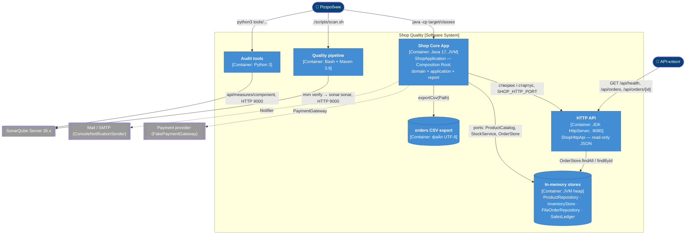

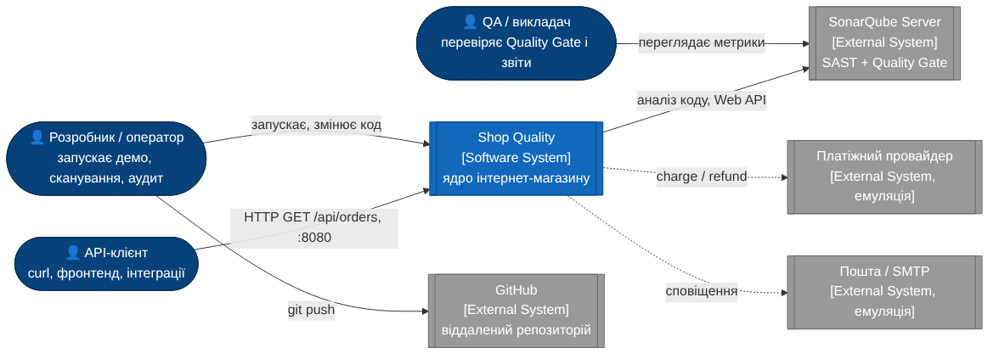
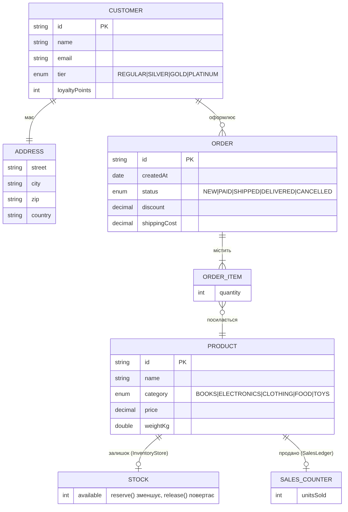

### 2.2 ISD — `docs/isd.md`

Повний текст: [docs/isd.md](isd.md). §1 топологія (локальна станція macOS, без контейнерів) і **порядок підняття** ·
§2 середовища dev / test / production (demo), реліз і відкат за тегом · §3 змінні середовища без секретів ·
§4 вузли D1–D5 (на кожен посилається SDD) · D3 — **CI/CD-конвеєр** зі стадіями, тригерами і Quality Gates ·
§5 моніторинг · §6 **резервне копіювання з RTO/RPO**.

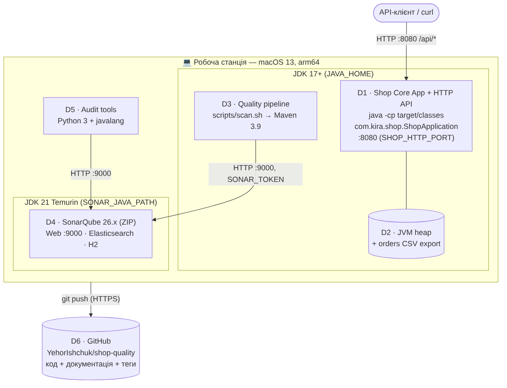
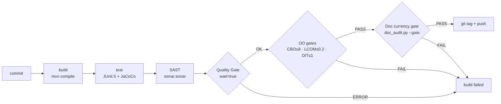

| Актив | RPO | RTO |
|---|---|---|
| Код, документація, теги (GitHub) | ≤ 1 робочий день | ≤ 15 хв |
| Дані замовлень (in-memory) | весь сеанс процесу (прийнятий ризик, ADR-0002) | ≈ 5 с |
| Історія аналізів SonarQube | усі аналізи після останньої копії `data/` | ≤ 30 хв |
| `SONAR_TOKEN` | — | ≤ 2 хв (перевипуск) |

### 2.3 Кущ ADR — `docs/architecture/adr/`

| ADR | Рішення | Розглянуті альтернативи | Ключові наслідки |
|---|---|---|---|
| [0001](architecture/adr/0001-hexagonal-ports-and-adapters.md) | порти та адаптери + ручний DI | залишити `StoreManager`; Spring Boot DI | CBO ≤ 8; новий адаптер підключається лише в Composition Root |
| [0002](architecture/adr/0002-in-memory-storage-with-csv-export.md) | сховище в пам'яті + CSV-експорт | PostgreSQL+JPA у Docker; файлова H2+JDBC | нуль залежностей; RPO = сеанс; назва `FileOrderRepository` історична |
| [0003](architecture/adr/0003-embedded-jdk-http-server.md) (з краш-тесту) | HTTP API на `HttpServer` JDK | Spring Boot; Javalin/Spark | D1 став сервісом, новий порт і порядок запуску |

ADR-0002 чесно позначено як рішення ЛР1, записане вперше під час аудиту. Текст не переписується, а при заміні сховища
отримає статус `Superseded`.

### 2.4 Матриця покриття аудиторій

| Аудиторія | Ключові питання | Документ-відповідь | Статус до | Статус після |
|---|---|---|---|---|
| **Новачок** | Як запустити проєкт локально? | README «Швидкий старт» | ❌ лише Docker-шлях | ✅ |
| | З чого почати знайомство? | README «Онбординг», handover §2 | ❌ | ✅ |
| **Бізнес** | Що система робить і для кого? | README перший абзац, SDD §1 | ❌ | ✅ |
| | Які обмеження (емуляції, дані в пам'яті)? | SDD §1, ADR-0002 | ❌ | ✅ |
| **Розробник** | З якими компонентами взаємодіє мій модуль? | SDD §4 (колонки «Взаємодіє з», «Залежить від портів») | ⚠️ blueprint частково | ✅ |
| | Чому архітектура саме така? | ADR-0001…0003 | ❌ | ✅ |
| | Яка модель даних? | SDD §5 | ❌ | ✅ |
| **QA** | Де описані контракти поведінки для перевірок? | SDD §6 (порти, REST, тести-контракти) | ❌ | ✅ |
| | Які критерії Quality Gate? | ISD D3, SDD §7 | ⚠️ лише в скрипті | ✅ |
| **DevOps** | Як розгорнути й відкотити реліз? | ISD §2 (реліз = тег, відкат = checkout тегу) | ❌ | ✅ |
| | Які змінні середовища і порти? | ISD §3, D1, D4 | ❌ | ✅ |
| | Що з бекапом, RTO/RPO? | ISD §6 | ❌ | ✅ |

Прогалини закрито на практиці: README доопрацьовано (призначення, швидкий старт, онбординг, карта документів).
Паспорт зафіксовано комітом `docs(architecture): deliver design and infrastructure passport`; повторний аудит:
**DOC CURRENCY GATE: PASS** ([reports/docs/02-passport.md](../reports/docs/02-passport.md)).

---

## Завдання 3. Супровід документації

### 3.1 Регламент підтримки — `docs/maintenance.md`

**Правило: «зміна коду = зміна документації».** Жодне злиття в `main` без оновлення зачеплених документів у тому ж
коміті / PR; перевіряється `python3 tools/doc_audit.py --gate` + чекліст `.github/pull_request_template.md`.

| Документ | Власник | Цикл перегляду | Дата останнього перегляду |
|---|---|---|---|
| README.md | Yehor Ishchuk | 90 днів (експлуатаційна) | 2026-11-21 |
| docs/sdd.md | Yehor Ishchuk | 180 днів (архітектурна) | 2026-11-21 |
| docs/isd.md | Yehor Ishchuk | 90 днів (експлуатаційна) | 2026-11-21 |
| ADR-0001, 0002, 0003 | Yehor Ishchuk | 180 днів (архітектурна) | 2026-11-21 |
| docs/maintenance.md | Yehor Ishchuk | 90 днів | 2026-11-21 |

### 3.2 Протокол краш-тесту «Documentation Decay» (FAIL)

**Контрольована зміна** (коміт `9c67cdf`, тег `lab10-decay-fail`): новий компонент і зміна поведінки, документи не чіпали.

```text
$ git diff --stat lab10-decay-fail~1 lab10-decay-fail
 src/main/java/com/kira/shop/ShopApplication.java | 17 +++-
 src/main/java/com/kira/shop/api/ShopHttpApi.java | 98 ++++++++++++++++++++++++
 src/test/java/com/kira/shop/ShopHttpApiTest.java | 51 ++++++++++++
 3 files changed, 164 insertions(+), 2 deletions(-)
```

```diff
@@ ShopApplication.main @@
         LOG.info(new CustomerInsightsService(orders).buildCustomerSummary(kira));
+
+        ShopHttpApi api = new ShopHttpApi(orders, httpPort());
+        api.start();
+        Runtime.getRuntime().addShutdownHook(new Thread(api::stop));
+        LOG.info(() -> "HTTP API listening on http://localhost:" + api.port() + "/api/orders (Ctrl+C to stop)");
+    }
+
+    private static int httpPort() {
+        String value = System.getenv("SHOP_HTTP_PORT");
+        return value == null || value.isBlank() ? DEFAULT_HTTP_PORT : Integer.parseInt(value.trim());
     }
```

Фактична нова поведінка ([docs/lab10/api-live-run.log](lab10/api-live-run.log)):

```text
INFO: HTTP API listening on http://localhost:18080/api/orders (Ctrl+C to stop)
$ curl -i localhost:18080/api/orders
HTTP/1.1 200 OK
Content-type: application/json; charset=utf-8
[{"orderId":"ORD-1","customer":"Kira","status":"PAID","items":4,"total":"31573.50"}]
$ curl -o /dev/null -w "%{http_code}" localhost:18080/api/orders/ORD-9
404
```

> 📸 **СКРІНШОТ 2:** запущений застосунок + `curl localhost:8080/api/orders` в іншому терміналі.

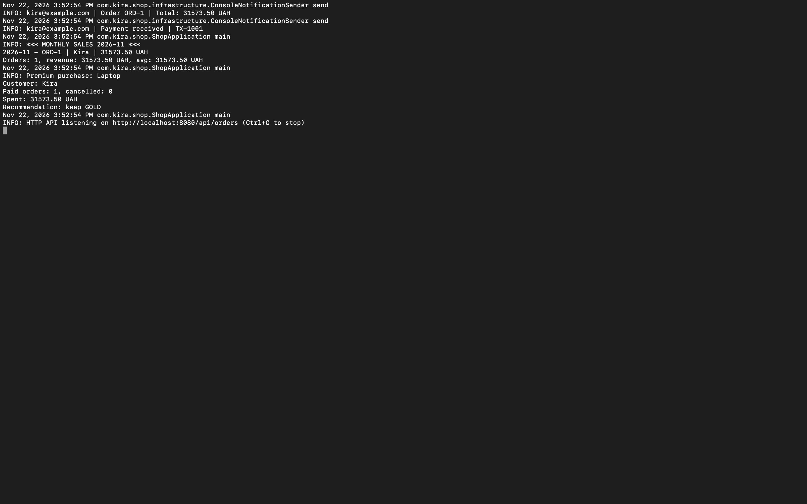

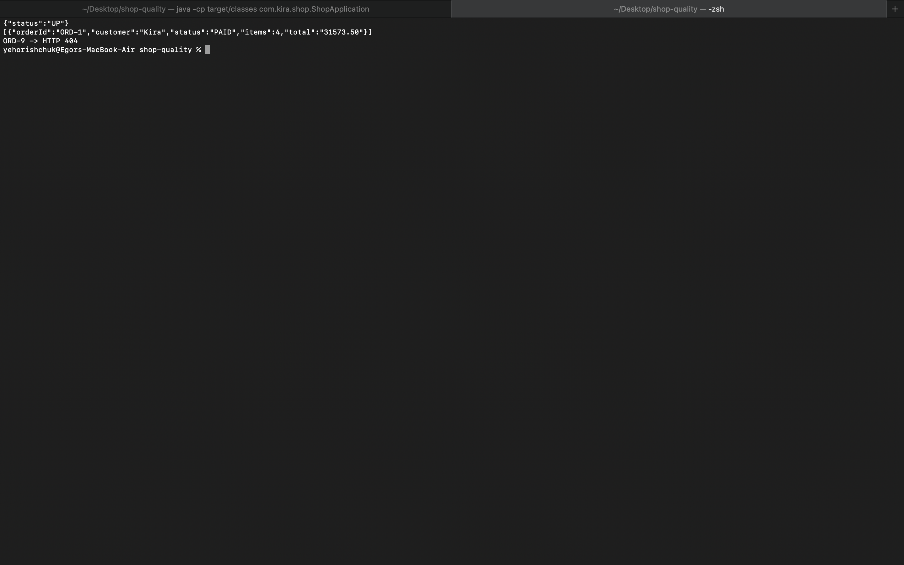

**Доказ дрейфу для кожної аудиторії** (документи у стані `lab10-decay-fail`):

| Аудиторія | Що каже документ | Що насправді | Дрейф |
|---|---|---|---|
| **Новачок, бізнес** | `README.md:22` — «Програма завершується сама з кодом 0»; про HTTP API ані слова | процес не завершується, слухає порт 8080 і віддає замовлення JSON-ом | README бреше про поведінку і можливості |
| **Розробники, QA** | `sdd.md:123` — Composition Root «виконує демо-сценарій … і **завершується**»; у C4 немає контейнера HTTP API; пакет `api/` і `ShopHttpApi` відсутні; у §6 немає REST-контракту | новий компонент `api/ShopHttpApi`, 3 маршрути, коди 200/404/405 | structure drift: QA не має контракту, розробник не бачить компонент |
| **DevOps** | `isd.md:72–74` — D1 «**одноразовий процес** … завершується з кодом 0», «**Мережевих портів не відкриває**»; `isd.md:42–44` — D1 «запускається будь-коли»; змінної `SHOP_HTTP_PORT` у §3 немає | D1 — довгоживучий сервіс на TCP 8080, падає при зайнятому порту, клієнтів можна запускати лише після health-check | порядок підняття сервісів змінено, ISD не відповідає розгортанню |

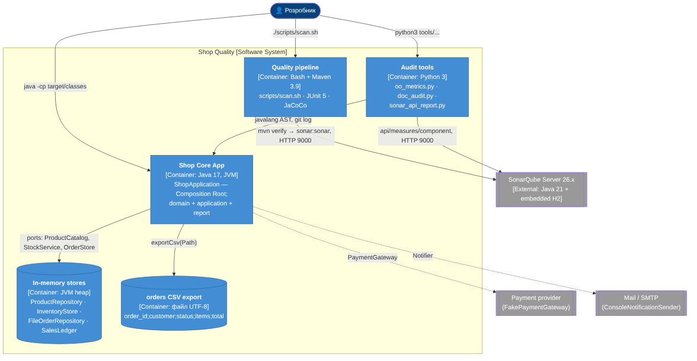

**Повторний аудит метрик** ([reports/docs/03-decay-fail.md](../reports/docs/03-decay-fail.md)):

```text
$ python3 tools/doc_audit.py --stage decay-fail --gate
$ git rev-list --count 447ce9f..HEAD -- src/main/java                          → 1
$ git rev-list --count 447ce9f..HEAD -- src/main/java/com/kira/shop/ShopApplication.java  → 1
- ❌ пакет `api/` описано в SDD
- ❌ компонент `ShopHttpApi` описано в SDD
- ❌ HTTP-маршрут `/api/health` описано в SDD / README
- ❌ HTTP-маршрут `/api/orders` описано в SDD / README
- ❌ змінну середовища `SHOP_HTTP_PORT` описано в ISD
DOC CURRENCY GATE: FAIL   (exit code 1)
```

> 📸 **СКРІНШОТ 3:** `git checkout lab10-decay-fail && python3 tools/doc_audit.py --gate; echo $?` → FAIL, `1`.
> На тезі лежить версія скрипта до виправлення хибно-позитивної перевірки `api/`, тому вона показує **6/22** провалів;
> збережений звіт `reports/docs/03-decay-fail.md` знято виправленим скриптом, тому там **7/22**. Вердикт однаковий: FAIL.

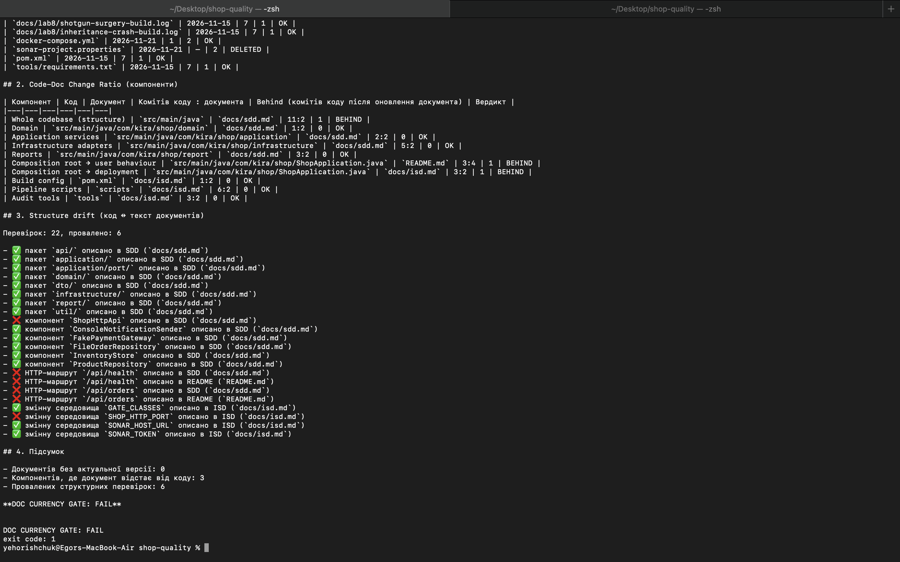

### 3.3 Протокол відновлення (PASS)

Коміт `c3fbea7` `docs(maintenance): restore documentation currency, PASS` (тег `lab10-docs-pass`):

| Документ | Оновлений фрагмент |
|---|---|
| README | «Програма продовжує працювати як сервіс, зупинка Ctrl+C», таблиця HTTP API (4 рядки), `SHOP_HTTP_PORT`, 23 тести |
| SDD | контейнер **HTTP API** і актор «API-клієнт» у C4 L1/L2; пакет `api/` у §4.1; новий §4.4 `ShopHttpApi`; Composition Root «залишається працювати до Ctrl+C»; §6.2 REST-контракт і схема `Order`; §7 безпека API |
| ISD | D1 — «довгоживучий процес-сервіс», TCP 8080, помилка при зайнятому порту; **новий порядок підняття** (build → D1 → health-check → клієнти); `SHOP_HTTP_PORT` у §3; моніторинг `GET /api/health`; RTO даних 5 с |
| ADR-0003 | нове рішення: вбудований `HttpServer` JDK проти Spring Boot / Javalin |
| maintenance.md | рядок ADR-0003, журнал позапланового перегляду |

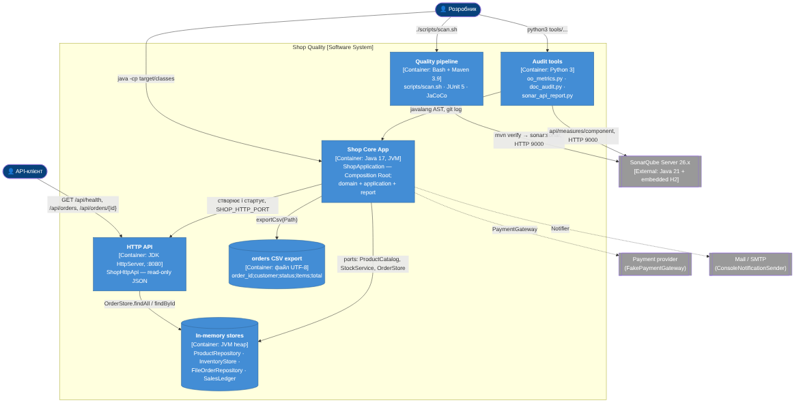

**Метрики до / після** ([02-passport](../reports/docs/02-passport.md) → [03-decay-fail](../reports/docs/03-decay-fail.md) → [04-restored-pass](../reports/docs/04-restored-pass.md)):

| Метрика | Паспорт (PASS) | Краш-тест (FAIL) | Відновлення (PASS) |
|---|---|---|---|
| Behind: `src/main/java` → SDD | 0 | **1** | 0 |
| Behind: `ShopApplication.java` → README | 0 | **1** | 0 |
| Behind: `ShopApplication.java` → ISD | 0 | **1** | 0 |
| Code-Doc ratio `src/main/java` : SDD | 10 : 1 | 11 : 2 | 12 : 3 |
| Структурні перевірки (провалено / всього) | 0 / 15 | **7 / 22** | 0 / 22 |
| Last Updated Age README / SDD / ISD, дн | 0 / 0 / 0 | 0 / 0 / 0 * | 0 / 0 / 0 |
| Матриця аудиторій | без прогалин | 3 аудиторії з прогалинами | без прогалин |
| **DOC CURRENCY GATE** | **PASS** | **FAIL** | **PASS** |

\* Вік у днях за один день не змінюється. Саме тому регламент спирається на Behind (відставання в комітах), а не лише на вік.
Під час FAIL знайдено і виправлено хибно-позитивну перевірку `api/` (збіг з `api/measures/...` у SDD): перевірка
пакетів тепер шукає назву саме в бектиках.

> 📸 **СКРІНШОТ 4:** `git checkout main && python3 tools/doc_audit.py --gate; echo $?` → PASS, `0`.

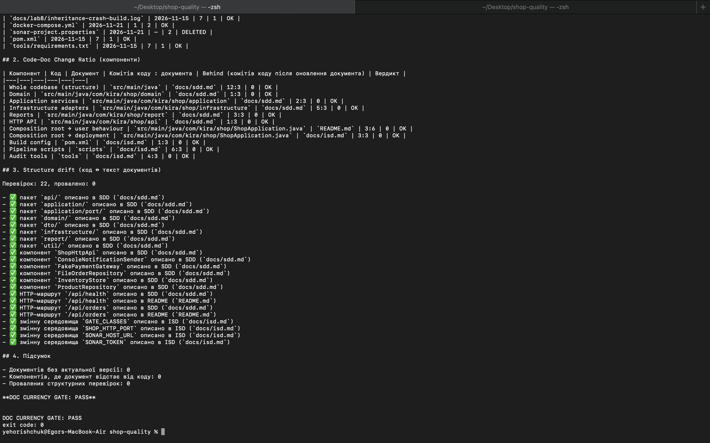

### 3.4 Handover-пакет — `docs/handover.md`

- **Реєстр документів** з власниками, циклами й статусом актуальності (усі ✅, DEMO/blueprint ⚠️ deprecated, звіти 🗄️ архів).
- **Онбординг у 5 кроків:** README → JDK/Maven/clone → `mvn verify` (23 тести) → запуск + `curl /api/health` → SDD §3–§6 і перша зміна з doc-гейтом.
- **Декларація Bus Factor** (`git shortlog -sn HEAD -- <компонент>`):

```text
$ git shortlog -sn HEAD -- src/main/java/com/kira/shop/application
     2	Yehor Ishchuk
$ git shortlog -sn HEAD -- src/main/java/com/kira/shop/infrastructure
     5	Yehor Ishchuk
$ git shortlog -sn HEAD -- tools/oo_metrics.py
     2	Yehor Ishchuk
$ git shortlog -sn HEAD -- scripts
     6	Yehor Ishchuk
```

  Bus Factor = 1 для всіх компонентів. Найвищий ризик: `tools/oo_metrics.py` (формули CK/MOOD, обмеження javalang) 🔴
  і розгортання SonarQube на macOS 🟠. План: парне володіння (другий власник у регламенті), `docs/oo-metrics.md`,
  розділ «Відомі проблеми» в ISD D4, doc-гейт у GitHub Actions (ЛР11). Бізнес-правила `StockAllocator` / `PricingService`,
  які раніше жили лише в коді, винесено в handover §4.
- **Вердикт:** система в стані **«Always Ready to Handover» з одним задекларованим ризиком**. Документація повна й актуальна,
  а дрейф автоматично ловиться doc-гейтом. Організаційний Bus Factor = 1 закривається заходами 1–2 плану.

---

## Усні питання: коротка шпаргалка

- **Документація продукту ≠ документація процесу.** Продукт (README, SDD, ISD, ADR) — «жива», змінюється разом із системою,
  має власника і цикл перегляду. Процес (звіти ЛР, логи, протоколи, повідомлення комітів) — «знімок» факту в часі,
  не оновлюється: виправити історію не можна, можна лише позначити deprecated.
- **SDD ≠ ISD.** SDD — **як система влаштована всередині**: компоненти, зв'язки, дані, контракти (розробник, QA).
  ISD — **де і на чому вона працює**: середовища, порти, змінні, конвеєр, бекап і RTO/RPO (DevOps).
  Тест: «додали клас» → SDD; «змінили порт / порядок запуску» → ISD; у краш-тесті змінилися обидва.
- **Documentation Decay vs Dead Documentation.** Decay — документ є і читається, але описує неіснуючу систему (README з Docker).
  Dead — документ є, але його ніхто не читає (`sonar-project.properties`).
- **ADR не переписується:** застаріле рішення → `Superseded by ADR-N`, нове → новий номер.

---

## Лог валідації ШІ-Техліда (протокол проходження краш-тесту)

**Декларація.** Роботу виконано в діалозі з ШІ-асистентом Claude (Anthropic). ШІ згенерував чернетки SDD, ISD, ADR,
регламенту, handover-пакета, код HTTP API і скрипт `tools/doc_audit.py`, а також виконав коміти (у трейлерах комітів —
`Co-Authored-By: Claude`). Регламент ЛР10 передбачає −3 бали, якщо архітектурний паспорт чи handover-пакет згенеровано
ШІ замість студента. Тому студент зобов'язаний особисто перевірити кожне твердження паспорта проти коду (таблиця нижче),
переформулювати документи своїми словами і бути готовим пояснити кожен рядок усно.

| # | Крок / твердження ШІ | Як перевірено | Результат |
|---|---|---|---|
| 1 | Базовий аудит: «усі документи OK за віком» | `git log -1 --format=%cs -- <файл>` вручну для README, DEMO | ✅ підтверджено; висновок «вік не ловить Decay» прийнято |
| 2 | SDD: у `STOCK` є поля `available` і `reserved` | читання `InventoryStore` | ❌ **помилка ШІ**: є лише `Map<Product,Integer>`, резерв зменшує залишок → виправлено |
| 3 | SDD: `CsvUtils` «екранує `;`» | читання `CsvUtils.escape` | ⚠️ неточно: лапки для `;`, `"` і `\n` → уточнено |
| 4 | ADR-0001: «10 портів» | `ls application/port/` | ❌ **помилка ШІ**: 9 інтерфейсів + клас `PaymentResult` → виправлено |
| 5 | Паспорт посилався на `maintenance.md` до його створення | перегляд посилань у коміті паспорта | ⚠️ битий лінк (сам по собі Decay!) → посилання додано разом із регламентом |
| 6 | Mermaid-діаграми рендеряться | рендер mermaid-cli у PNG + перегляд у Obsidian/GitHub | ✅ 5/5 діаграм; підписи стрілок взято в лапки |
| 7 | FAIL-стан: зміна лише в коді | `git show --stat lab10-decay-fail` | ✅ 3 файли, лише `src/` |
| 8 | Doc-гейт у FAIL: «пакет `api/` описано в SDD ✅» | ручний пошук `api/` у SDD | ❌ **хибно-позитивний результат**: збіг з `api/measures/component` → перевірку виправлено на `` `api/` `` |
| 9 | API реально працює | запуск + `curl` 200 / 404, тест `ShopHttpApiTest` (23/23 зелені) | ✅ |
| 10 | PASS: метрики повернулися в норму | `doc_audit.py --gate` → exit 0, Behind = 0, 0/22 провалів | ✅ |
| 11 | Handover: правила знижок і резервування | звірка з `PricingService`, `StockAllocator`, `FakePaymentGateway` | ✅ (2 % книжковий бонус від 3 од., ліміт 50 000) |
| 12 | Bus Factor = 1 | `git shortlog -sn HEAD -- <шлях>` для 9 шляхів | ✅ |

**Висновок.** З 12 перевірених кроків у 4 ШІ помилився (2, 4, 8 — фактичні помилки, 5 — битий лінк), ще в одному (3)
був неточним. Усі помилки знайдено звіркою з кодом і виправлено до фінальних комітів. Найважливіший урок краш-тесту:
документ, написаний «впевнено» (людиною чи ШІ), але не звірений з кодом, і є Documentation Decay з першого дня.
