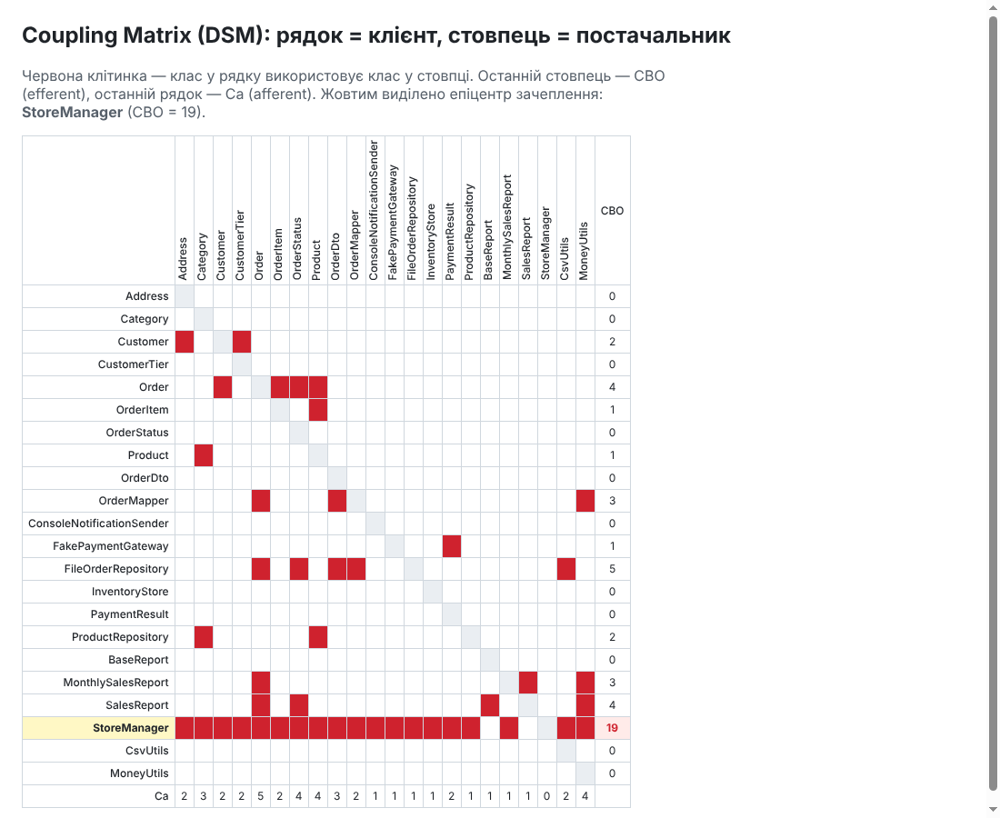
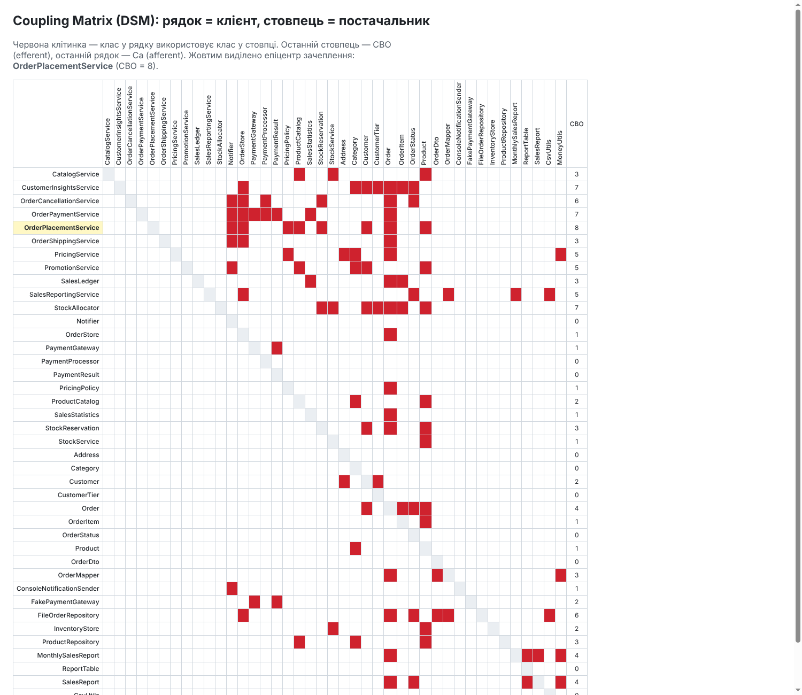

# Лабораторна робота №8. ООП-аудит системного дизайну та інтерфейсна декомпозиція класів-мутантів

> 🗄️ **Історичний документ процесу (ЛР8, 2026-11-15)** — фіксує стан системи на момент виконання і не оновлюється.
> Актуальна архітектура — [SDD](sdd.md), розгортання — [ISD](isd.md).

> Project Hub-звіт. Поля `⟨…⟩` — дані з вашого SonarQube (сирі JSON, скріншоти) після
> виконання `docs/DEMO.md` §3. Метрики CK / Lorenz-Kidd / MOOD пораховано `tools/oo_metrics.py`
> і закомічено в `reports/oo/<stage>/`.

## 0. Інструментарій і важливе обмеження SonarQube

| Роль | Інструмент |
|---|---|
| Analytical Metric Server | SonarQube Community Edition у Docker (`docker-compose.yml`, :9000) |
| REST-клієнт | `curl` (`scripts/sonar-api-measures.sh`), PowerShell `Invoke-RestMethod` (`.ps1`), Python `tools/sonar_api_report.py` |
| CK / MOOD / Coupling Matrix | `tools/oo_metrics.py` (парсинг AST через `javalang`) |
| Візуалізація | `reports/oo/<stage>/coupling-matrix.html` (DSM), `dependency-graph.mmd` (Mermaid) |

Метрики `class_complexity`, `coupling_between_objects`, `lcom4` з прикладу методички в сучасному
SonarQube **відсутні** (LCOM4 і DSM видалено ще у версіях 4.x–5.x; CBO/DIT у ядрі ніколи не було).
Запит із цими ключами повертає помилку — її сира відповідь зберігається як доказ
(`reports/sonar-raw/<stage>/ck-legacy-keys.json`). Тому:
- з **Web API** беруться `complexity` (= WMC), `cognitive_complexity`, `ncloc`, `functions`, `code_smells`, `sqale_index`;
- **CBO, Ca, RFC, LCOM (Henderson-Sellers), LCOM4, DIT, NOC, NMO, PIM, MOOD** — з `tools/oo_metrics.py`,
  об'єднуються з JSON Sonar у `reports/<stage>/ck-mood-report.md`.

Визначення: CBO — кількість різних класів проєкту, які використовує клас (Ce); LCOM — LCOM* Хендерсон-Селлерса
∈ [0;1] (0 — ідеальна згуртованість; тривіальні getter/setter виключено); LCOM4 — кількість незв'язних груп
методів; DIT — глибина успадкування (клас без `extends` = 1).

---

## Завдання 1. Програмний видобуток ООП-паспортів

### 1.1 Декларація API-запитів
```bash
curl -u $SONAR_TOKEN: "http://localhost:9000/api/measures/component?component=shop-quality:src/main/java/com/kira/shop/domain/Order.java&metricKeys=complexity,cognitive_complexity,ncloc,functions,code_smells,sqale_index"
curl -u $SONAR_TOKEN: "http://localhost:9000/api/measures/component?component=shop-quality:src/main/java/com/kira/shop/infrastructure/FileOrderRepository.java&metricKeys=complexity,cognitive_complexity,ncloc,functions,code_smells,sqale_index"
curl -u $SONAR_TOKEN: "http://localhost:9000/api/measures/component?component=shop-quality:src/main/java/com/kira/shop/dto/OrderDto.java&metricKeys=complexity,cognitive_complexity,ncloc,functions,code_smells,sqale_index"
# ключі CK з методички -> "The following metric keys are not found"
curl -u $SONAR_TOKEN: "http://localhost:9000/api/measures/component?component=shop-quality:src/main/java/com/kira/shop/domain/Order.java&metricKeys=class_complexity,coupling_between_objects,lcom4"
```
PowerShell-еквівалент: `scripts/sonar-api-measures.ps1`. Скріншот/лог виконання: ⟨…⟩

### 1.2 Аналітичний JSON-пакет (фрагмент)
```json
⟨вставити з reports/sonar-raw/baseline/Order.json, наприклад:
{ "component": { "key": "shop-quality:src/main/java/com/kira/shop/domain/Order.java",
  "measures": [ {"metric": "complexity", "value": "…"}, {"metric": "cognitive_complexity", "value": "…"} ] } }⟩
```

### 1.3 Зведена таблиця CK & MOOD — Baseline (тег `lab8-baseline`)

| Роль | Файл | WMC | Cognitive (Sonar) | CBO | Ca | RFC | LCOM | LCOM4 | DIT |
|---|---|---|---|---|---|---|---|---|---|
| Core Domain | `Order.java` | 26 | ⟨…⟩ | 4 | 5 | 34 | 0.857 | 1 | 1 |
| Infrastructure | `FileOrderRepository.java` | 10 | ⟨…⟩ | 5 | 1 | 25 | 0.0 | 1 | 1 |
| Utility / DTO | `OrderDto.java` | 6 | ⟨…⟩ | 0 | 3 | 6 | 0.0 | 0 | 1 |
| **Епіцентр** | `StoreManager.java` | **67** | ⟨…⟩ | **19** | 0 | **141** | **0.855** | **2** | 1 |

WMC = сума цикломатичної складності методів (збігається з `complexity` Sonar для файлу з одним класом).

| MOOD (система, 22 класи) | MHF | AHF | MIF | AIF | COF | PF |
|---|---|---|---|---|---|---|
| Baseline | 7.9 % | 100 % | 13.6 % | 0 % | 9.3 % | 31.2 % |

### 1.4 Первинний вердикт
- **Інкапсуляція полів зразкова** (AHF = 100 % — жодного публічного поля), **MHF низький** (7.9 %): майже всі
  методи публічні, приховані лише кілька хелперів — інтерфейси класів «широкі».
- **COF = 9.3 %** для системи загалом прийнятний, але зачеплення розподілене вкрай нерівномірно:
  один клас `StoreManager` відповідає за 19 із ≈ 43 зв'язків системи.
- `StoreManager` — **клас-мутант (God Object)**: CBO 19 (> 15), RFC 141, WMC 67, 29 методів,
  LCOM 0.855 (методи працюють з різними підмножинами полів: склад, оплата, транзакції, статистика)
  і LCOM4 = 2 (клас розпадається на незв'язні частини).
- `Order` має високий LCOM* (0.857) при LCOM4 = 1: це агрегат, у якого кожен метод зачіпає частину стану
  (позиції / статус / суми) — розділяти не потрібно, LCOM4 це підтверджує.
- У пакеті `report` — вертикальна аномалія: `MonthlySalesReport` DIT = 3, перевизначає 6 із 7 методів
  (див. Завд.3).
- Ознак спагеті-коду на рівні класів домену/інфраструктури немає (CBO ≤ 5); проблема локалізована у сервісному шарі.

---

## Завдання 2. Локалізація та ліквідація God Object

### 2.1 Baseline Coupling Matrix


Суцільний червоний рядок `StoreManager` — клас використовує майже всі типи системи (CBO 19).
Інтерактивна версія: `reports/oo/baseline/coupling-matrix.html`.

### 2.2 Протокол симуляції збою (Shotgun Surgery) — тег `lab8-godobject-fail`
Зміна в сторонньому класі — `InventoryStore` ідентифікує залишок через `Product`, а не `String id`:
```java
-    public int getStock(String productId) {
+    public int getStock(Product product) {
```
Результат (`docs/lab8/shotgun-surgery-build.log`):
```
StoreManager.java:74:  error: incompatible types: String cannot be converted to Product   (registerProduct)
StoreManager.java:79:  error: ...                                                          (restock)
StoreManager.java:83:  error: ...                                                          (isAvailable)
StoreManager.java:89:  error: ...                                                          (lowStockReport)
StoreManager.java:126: error: ...                                                          (resolveQuantity)
StoreManager.java:141: error: ...                                                          (reserveStock)
StoreManager.java:224: error: ...                                                          (cancelOrder)
7 errors
```
Одна точкова зміна → 7 правок у 7 різних методах God Object, які відповідають за різні бізнес-задачі.
Коміт: `arch(audit): capture god object coupling failure, FAIL`.

### 2.3 Інтерфейсна декомпозиція — тег `lab8-godobject-pass`
Повна схема і таблиця метрик: [`docs/lab8/architecture-blueprint.md`](lab8/architecture-blueprint.md).

- `StoreManager` видалено; його обов'язки розподілено за SRP між use-case сервісами
  (`OrderPlacementService`, `OrderPaymentService`, `OrderShippingService`, `OrderCancellationService`,
  `CatalogService`, `PromotionService`, `CustomerInsightsService`, `SalesReportingService`) та
  політиками (`PricingService`, `StockAllocator`, `SalesLedger`).
- 9 контрактів у `application.port`: `ProductCatalog`, `StockService`, `OrderStore`, `PaymentGateway`,
  `Notifier`, `PricingPolicy`, `StockReservation`, `PaymentProcessor`, `SalesStatistics`;
  адаптери інфраструктури їх реалізують.
- Усі залежності — через конструктор і лише на інтерфейси (DIP/DI). Приклад:
```java
public OrderCancellationService(OrderStore orders, StockReservation stock,
                                PaymentProcessor payments, Notifier notifier) { ... }
```
- Зміна контракту складу з FAIL-коміту лишилась у коді, але тепер її «поглинають» лише `StockService`
  і два його клієнти (`StockAllocator`, `CatalogService`).

### 2.4 Інструментальна валідація
`./scripts/oo-gate-god-object.sh` (`reports/oo/god-object-pass/oo-gate.txt`):
```
PASS OrderPlacementService: CBO=8 LCOM=0.0      PASS PromotionService: CBO=5 LCOM=0.0
PASS OrderPaymentService:   CBO=7 LCOM=0.0      PASS CustomerInsightsService: CBO=7 LCOM=0.0
PASS OrderShippingService:  CBO=3 LCOM=0.0      PASS SalesReportingService: CBO=5 LCOM=0.0
PASS OrderCancellationService: CBO=6 LCOM=0.0   PASS PricingService: CBO=5 LCOM=0.0
PASS CatalogService:        CBO=3 LCOM=0.0      PASS StockAllocator: CBO=7 LCOM=0.0
PASS SalesLedger:           CBO=3 LCOM=0.0
OO GATE: PASS
```

| | God Object (до) | Найгірший новий клас (після) | Ліміт |
|---|---|---|---|
| CBO | 19 | 8 (`OrderPlacementService`) | ≤ 8 ✅ |
| LCOM (HS) | 0.855 | 0.0 | ≤ 0.2 ✅ |
| LCOM4 | 2 | 1 (окрім stateless `PricingService` = 2) | 1 |
| WMC | 67 | 13 (`StockAllocator`, `PricingService`, `CustomerInsightsService`) | — |
| RFC | 141 | 41 (`CustomerInsightsService`) | — |
| COF (система) | 9.3 % | 6.0 % | ↓ |

Дані Sonar після рефакторингу (`python tools/sonar_api_report.py --stage god-object-pass --oo reports/oo/god-object-pass/oo-metrics.json`):
⟨вставити таблицю з reports/god-object-pass/ck-mood-report.md + скріншот Quality Gate PASSED⟩

Матриця після рефакторингу: стовпці сервісів і адаптерів інфраструктури порожні — жоден сервіс не
залежить від іншого сервісу чи конкретного адаптера, лише від портів.


---

## Завдання 3. Вертикальний аудит (Лоренц-Кід) та деструкція Inheritance Hell

### 3.1 Baseline — тег `lab8-inheritance-baseline`
`BaseReport` → `SalesReport` → `MonthlySalesReport`

| Клас | DIT | NOC | NOM | NMO (перевизначені) | NMA (нові) | PIM |
|---|---|---|---|---|---|---|
| BaseReport | 1 | 1 | 14 | 0 | 14 | 14 |
| SalesReport | 2 | 1 | 8 | 4 (`header, formatRow, footer, clear`) | 4 | 18 |
| MonthlySalesReport | **3** | 0 | 7 | **6** (`addSale, header, formatRow, footer, renderCsv, render`) | 1 | 19 |

`MonthlySalesReport` перевизначає 86 % власних методів — нащадок фактично переписує предка,
а його поведінка залежить від внутрішніх деталей двох рівнів вище. Гейт (DIT ≤ 1, NMO = 0): **FAIL**.

### 3.2 Каскадний злам — тег `lab8-inheritance-fail`
Зміна лише в базовому класі: `formatRow(String[] cells)` → `formatRow(List<String> cells)`.
```
SalesReport.java:47: error: method does not override or implement a method from a supertype
```
«Аварійне виправлення» (видалити `@Override` у нащадках) компілюється, але `formatRow(String[])`
нащадків стає перевантаженням і більше не викликається з `BaseReport.render()` — рядки звіту
втрачають оформлення **мовчки**. Це ловить характеризаційний тест:
```
FAIL com.kira.shop.ReportTest.rowsAreDecoratedByConcreteReport: java.lang.AssertionError
Tests passed: 20, failed: 1
```
Лог: `docs/lab8/inheritance-crash-build.log`. Коміт: `arch(audit): capture inheritance fragility crash, FAIL`.

### 3.3 Replace Inheritance with Composition — тег `lab8-inheritance-pass`
**До:**
```java
public class SalesReport extends BaseReport {
    public SalesReport(String title) { super(title); }
    @Override public String formatRow(String[] cells) { return "- " + String.join(getSeparator(), cells); }
    @Override public String header() { ... }   @Override public String footer() { ... }   @Override public void clear() { ... }
}
public class MonthlySalesReport extends SalesReport {
    @Override public void addSale(Order order) { if (...) super.addSale(order); }
    @Override public String formatRow(String[] cells) { return month + " " + super.formatRow(cells); }
    ... ще 4 @Override
}
```
**Після:**
```java
public final class ReportTable {                       // колишній BaseReport, без нащадків
    public String render(String header, String footer, UnaryOperator<String> rowDecorator) { ... }
}
public class SalesReport {
    private final ReportTable table;                  // композиція
    public SalesReport(String title, ReportTable table) { ... }    // DI через конструктор
    public String render() { return renderWith(header(), footer(), row -> row); }
    public String renderWith(String h, String f, UnaryOperator<String> prefix) {
        return table.render(h, f, row -> prefix.apply("- " + row));   // делегування
    }
}
public class MonthlySalesReport {
    private final SalesReport sales;                  // композиція
    public MonthlySalesReport(YearMonth month, SalesReport sales) { ... }
    public String render() { return sales.renderWith(header(), footer(), row -> month + " " + row); }
}
```
Точки розширення — явні параметри (`header`, `footer`, `rowDecorator`), а не перевизначення
внутрішніх методів предка. Новий API рядків `List<String>` з FAIL-коміту збережено — тепер він
зачіпає лише `ReportTable`.

### 3.4 Фінальна валідація
`GATE_CLASSES=ReportTable,SalesReport,MonthlySalesReport ./scripts/oo-gate-inheritance.sh`:
```
PASS ReportTable:        CBO=0 DIT=1 NMO=0
PASS SalesReport:        CBO=4 DIT=1 NMO=0
PASS MonthlySalesReport: CBO=4 DIT=1 NMO=0
OO GATE: PASS
```
| | До | Після |
|---|---|---|
| DIT (`MonthlySalesReport`) | 3 | **1** |
| NMO (сумарно в ієрархії) | 10 | **0** |
| PIM (`MonthlySalesReport`) | 19 | 7 |
| MIF / PF (система) | 13.5 % / 31.2 % | 0 % / 0 % |

⟨скріншот Quality Gate PASSED після сканування тегу `lab8-inheritance-pass`⟩

---

## Логи Git History
```
$ git log --oneline --decorate
cfc24c9 (tag: lab8-inheritance-pass)     refactor(audit): replace inheritance with composition pattern, PASS
c258da2 (tag: lab8-inheritance-fail)     arch(audit): capture inheritance fragility crash, FAIL
a33cc85 (tag: lab8-inheritance-baseline) arch(audit): capture inheritance hierarchy baseline (Lorenz-Kidd)
155d6e7 (tag: lab8-godobject-pass)       refactor(audit): eliminate god object via interface decomposition, PASS
ccc663c (tag: lab8-godobject-fail)       arch(audit): capture god object coupling failure, FAIL
8fac580 (tag: lab8-baseline)             arch(audit): capture OO design baseline (CK & MOOD metrics, coupling matrix)
```
(хеші можуть відрізнятися — дивіться свій `git log`) ⟨скріншот дерева комітів⟩

## Лог валідації ШІ-Техліда
⟨Протокол згідно з інструкцією викладача — інструкції в методичці немає, додайте за вимогою⟩
