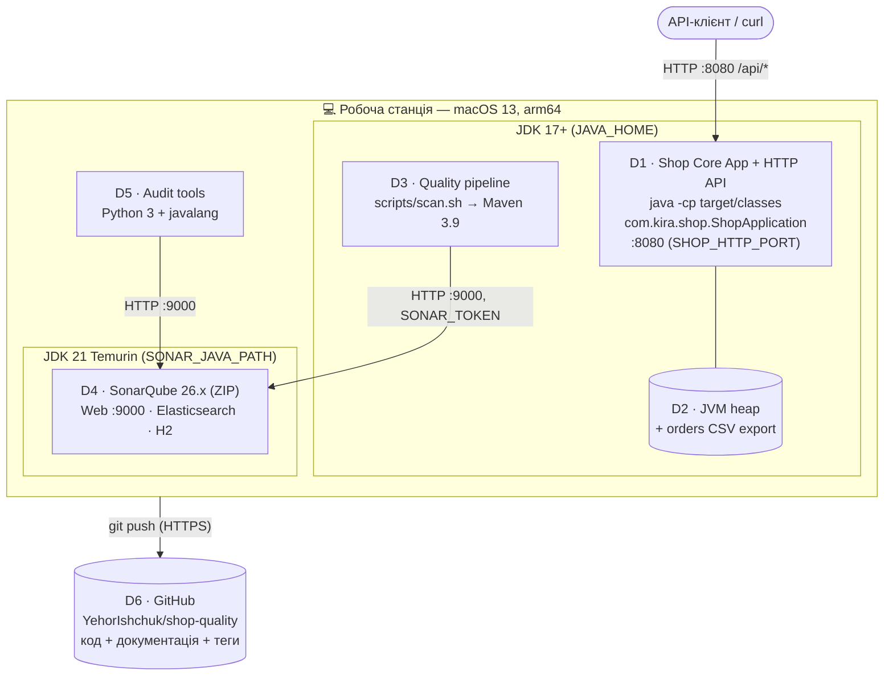
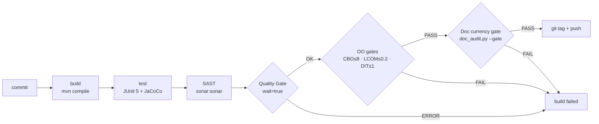

# ISD — Infrastructure Specification Document: Shop Quality

> **Де і на чому працює система.** Внутрішня структура — [SDD](sdd.md). Рішення — [ADR](adr/index.md).
> Кожен компонент SDD посилається сюди на свій вузол розгортання `D1…D6`.

## 1. Топологія розгортання

Система розгортається **локально на робочій станції розробника**, без контейнерів і хмари:
MacBook Air (Apple Silicon, macOS 13), JDK 17+ для збірки та запуску, окремий JDK 21 для SonarQube.
`docker-compose.yml` залишено як **альтернативний** спосіб підняти SonarQube на Linux/Windows,
у робочому середовищі він не використовується (Docker Desktop недоступний).



**Порядок підняття сервісів (змінено 2026-11-21):**

1. D3 — `mvn -B clean verify` (збирає `target/classes`, проганяє тести; SonarQube для цього не потрібен).
2. **D1 — запустити як довгоживучий сервіс** в окремому терміналі; переконатися, що порт `8080` (або `SHOP_HTTP_PORT`)
   вільний; дочекатися рядка `HTTP API listening…` і перевірити `curl -s localhost:8080/api/health` → `{"status":"UP"}`.
   **Лише після цього** запускати API-клієнтів.
3. D4 SonarQube — `sonar.sh start`, дочекатися `UP` на `:9000`; потім `scripts/scan.sh` (аналіз) — незалежно від D1.
4. D5 — після D3/D4 (читає метрики з D4) або автономно (`oo_metrics.py`, `doc_audit.py`).
Зупинка: `Ctrl+C` у терміналі D1 (shutdown hook закриває HTTP-сервер), `sonar.sh stop` для D4.

## 2. Середовища

| Середовище | Де | Призначення | Як потрапляє код | Критерій виходу |
|---|---|---|---|---|
| **dev** | IDE / VS Code на робочій станції | розробка, локальний запуск D1 | робоча копія | `mvn verify` зелений |
| **test** | та сама станція: Maven + SonarQube D4 | автотести, покриття JaCoCo, SAST, OO-гейти, doc-гейт | коміт у `main` | Quality Gate `OK`, `OO GATE: PASS`, `DOC CURRENCY GATE: PASS` |
| **production (demo)** | JVM на станції / ноутбук на захисті | демонстрація стану системи і HTTP API | git-тег (`lab*-pass`, `lab10-*`) з GitHub | демо-сценарій пройшов, `GET /api/health` → 200 |

**Реліз** = анотований git-тег на `main` + `git push --tags`. **Відкат** = `git checkout <попередній тег>`
→ `mvn -B clean verify` → зупинити поточний D1 (`Ctrl+C`) → запуск D1 з попереднього тегу (≈ 2 хв). Стани FAIL з ЛР8 навмисно не компілюються — на них не відкочуємось.

## 3. Змінні середовища (без значень секретів)

| Змінна | Де використовується | Значення / приклад | Секрет |
|---|---|---|---|
| `SONAR_TOKEN` | `scripts/scan.sh`, `setup-quality-gate.sh`, `sonar-api-measures.sh`, `quality-gate-status.sh` | токен `squ_…` (My Account → Security) — лише в shell, **ніколи** не комітиться; `.env` у `.gitignore` | так |
| `SONAR_HOST_URL` | ті самі скрипти, `tools/sonar_api_report.py` | `http://localhost:9000` (за замовчуванням) | ні |
| `SONAR_JAVA_PATH` | запуск D4 `sonar.sh` | `/Library/Java/JavaVirtualMachines/temurin-21.jdk/Contents/Home/bin/java` | ні |
| `JAVA_HOME` | Maven, D1 | JDK 17+ (на станції — 21/22) | ні |
| `SHOP_HTTP_PORT` | `ShopApplication` → `ShopHttpApi` | порт HTTP API, за замовч. `8080`; `0` — випадковий вільний | ні |
| `DEPLOY_DIR` | `scripts/deploy-api.sh` (RB-001) | каталог релізів і PID, за замовч. `~/shop-deploy` | ні |
| `BUILD_CMD` | `scripts/deploy-api.sh`, `scripts/restore-drill.sh` | команда збірки, за замовч. `mvn -B -q -DskipTests package` / `mvn -B -q verify` | ні |
| `MKDOCS_CMD` | `scripts/restore-drill.sh` | збірка бази знань у drill, за замовч. `mkdocs build --strict -q` | ні |
| `BACKUP_DIR` | `scripts/backup.sh` | носій №2 для копій, напр. `/Volumes/ShopBackup` | ні |
| `BACKUP_PASSPHRASE` | `scripts/backup.sh`, `scripts/restore-drill.sh` | ключ шифрування AES-256 — лише з Keychain / менеджера паролів | **так** |
| `GATE_CLASSES` | `scripts/oo-gate-inheritance.sh` | список класів, за замовч. `ReportTable,SalesReport,MonthlySalesReport` | ні |

## 4. Вузли розгортання

<a id="d1"></a>

### D1 · Shop Core App (JVM)

- Збірка: `mvn -B clean verify` → `target/classes`, звіт покриття `target/site/jacoco/jacoco.xml`.
- Запуск: `java -cp target/classes com.kira.shop.ShopApplication` — **довгоживучий процес-сервіс**: виконує демо-сценарій,
  друкує місячний звіт і резюме клієнта в лог (`java.util.logging`, stderr), стартує HTTP API і працює до `Ctrl+C`.
- Відкриває TCP-порт **8080** (`SHOP_HTTP_PORT`) на всіх інтерфейсах; при зайнятому порту падає на старті з
  `Cannot bind HTTP API to port …`. Health-check: `GET /api/health`. Зовнішніх runtime-залежностей немає (лише JDK, модуль `jdk.httpserver`).
- Тільки локальна мережа/демо: API без автентифікації, порт не публікувати назовні (SDD §7).
- Відповіді містять `Access-Control-Allow-Origin: *`, щоб «Try it out» у Swagger UI бази знань (`mkdocs serve` або GitHub Pages) міг викликати локальний API.

<a id="d2"></a>

### D2 · Сховища даних

- Каталог, залишки, замовлення, статистика — колекції в **JVM heap** процесу D1 (див. [ADR-0002](adr/0002-in-memory-storage-with-csv-export.md)).
- Персистентний артефакт — CSV-експорт замовлень `FileOrderRepository.exportCsv(Path)`, шлях задає викликач (UTF-8, `;`).
- Сховище SonarQube — вбудована H2 у `sonarqube-26.x/data/` (лише для навчального інстансу).

<a id="d3"></a>

### D3 · CI/CD-конвеєри

**Код** — локальні Bash-скрипти, які запускаються вручну перед `git push` і на кожному стані-тегу (схема нижче).
**Документація** — хмарний конвеєр GitHub Actions `.github/workflows/docs.yml` на кожен push і pull request у `main`
(ЛР11): job `build` (markdownlint → review-date audit → doc currency gate → `mkdocs build --strict` → Javadoc),
job `api-contract` (Spectral → Schemathesis проти живого API → генерація і компіляція SDK) і `deploy` на
GitHub Pages лише після обох зелених job. Сайт: <https://yehorishchuk.github.io/shop-quality/>.



| Стадія | Команда | Тригер | Quality Gate / критерій |
|---|---|---|---|
| build + test + coverage | `mvn -B clean verify` | кожен коміт (вручну) | усі тести зелені |
| SAST | `scripts/scan.sh` (`sonar:sonar`, `sonar.qualitygate.wait=true`) | перед push, на кожному тезі | «Shop-Quality-Gate»: new bugs = 0, new hotspots reviewed = 100 %, duplicated lines ≤ 3 %, Maintainability = A |
| OO-гейти (ЛР8) | `scripts/oo-gate-god-object.sh check`, `scripts/oo-gate-inheritance.sh check` | зміни в `application/`, `report/` | CBO ≤ 8, LCOM ≤ 0.2, DIT ≤ 1, NMO = 0 |
| Doc-гейт (ЛР10) | `python3 tools/doc_audit.py --gate` | кожен push / PR (GitHub Actions `docs.yml`) | `DOC CURRENCY GATE: PASS` |
| Конвеєр документації (ЛР11) | `.github/workflows/docs.yml` | кожен push / PR у `main` | markdownlint 0 errors · strict build Exit 0 · Spectral 0 errors · Schemathesis 0 failures → deploy Pages |
| реліз | `git tag -a <name> && git push --follow-tags` | стан лабораторної | усі гейти PASS |

<a id="d4"></a>

### D4 · SonarQube Server 26.x (ZIP-дистрибутив)

- Каталог: `~/sonarqube-26.x`; старт: `export SONAR_JAVA_PATH=…temurin-21…/bin/java && ./bin/macosx-universal-64/sonar.sh start`.
- Вимоги: JDK 21 (на JDK 17 — `UnsupportedClassVersionError`), **≥ 23 ГБ вільного місця** (поріг disk watermark Elasticsearch),
  у macOS — Full Disk Access для Terminal, якщо дистрибутив у `~/Downloads`.
- Порт `9000`; логи `logs/sonar.log`, `logs/es.log`, `logs/web.log`; зупинка `sonar.sh stop`.
- Налаштування гейта відтворюється скриптом `scripts/setup-quality-gate.sh` (ідемпотентний).

<a id="d5"></a>

### D5 · Audit tools (Python)

- `pip install -r tools/requirements.txt` (`javalang==0.13.0`), Python ≥ 3.9.
- `tools/oo_metrics.py` → `reports/oo/<stage>/`; `tools/sonar_api_report.py` → таблиці з Web API; `tools/doc_audit.py` → `reports/docs/`.

## 5. Моніторинг

| Що | Інструмент | Цільове значення | Дія при відхиленні |
|---|---|---|---|
| Стан D4 | `curl -s localhost:9000/api/system/status` | `{"status":"UP"}` до 3 хв після старту | `logs/es.log` → вільне місце / версія Java |
| Якість коду | `scripts/quality-gate-status.sh` | `projectStatus.status = OK` | блок релізу, виправлення до PASS |
| Архітектура | `scripts/oo-gate-*.sh check` | `OO GATE: PASS` | рефакторинг до PASS |
| Актуальність документації | `tools/doc_audit.py --gate` | `DOC CURRENCY GATE: PASS`, Behind = 0 | оновити документ у тому ж PR/коміті |
| Доступність і латентність D1 | `tools/sli_probe.py --check`, health-перевірка | SLO з [slo.yaml](../slo.yaml); алерти A-01…A-03 ([каталог](../runbooks/alerts.md)) | [[RB-001]] |
| Робота D1 | лог JUL у stderr | рядки звіту без `SEVERE` | розбір стек-трейсу, тест на регресію |

<a id="d6-backup"></a><a id="d6"></a>

## 6. Резервне копіювання, RTO / RPO і restore drill

### 6.1 Цільові RTO / RPO з розрахунком

**RTO** (допустимий час відновлення) = виявлення + рішення + сума часу кроків відновлення.
**RPO** (допустима втрата даних) = максимальний інтервал між двома копіями.

| Актив | RPO | Розрахунок RPO | RTO | Розрахунок RTO |
|---|---|---|---|---|
| Код, документація, теги | **≤ 24 год** | push на GitHub щонайменше раз на робочий день + щоденна інкрементна копія → найгірше втрачається робота з моменту останньої копії, ≤ 1 доба | **≤ 15 хв** | виявлення 2 хв + розшифрування й verify 1 хв + clone 1 хв + `mvn verify` 3 хв + `pip install` і strict-збірка 3 хв + запуск і health 1 хв = **11 хв** (+ 4 хв запасу). Факт drill #2: 20 с (кеш залежностей) |
| D1 · HTTP API (процес) | — (стану немає) | процес не зберігає даних поза пам'яттю | **≤ 5 хв** | алерт A-01 (90 с) + рішення 1 хв + перезапуск/відкат за RB-001 (10 с без збірки, ≤ 2 хв зі збіркою) = **≈ 4,5 хв**. Факт: відкат 2 с до health UP ([лог](https://github.com/YehorIshchuk/shop-quality/blob/main/docs/reports/lab12/deploy-rollback.log)) |
| D2 · дані замовлень у JVM heap | **весь сеанс процесу** | прийнятий ризик ADR-0002: демо-дані засіваються заново при старті; реальних клієнтських даних немає | ≈ 5 с | перезапуск D1 до health = 200 |
| Історія аналізів SonarQube | ≤ 7 днів | копія каталогу `data/` при зупиненому D4 щонеділі | ≤ 30 хв | перевстановлення ZIP 10 хв + `setup-quality-gate.sh` 2 хв + пересканування тегів 15 хв |
| `SONAR_TOKEN` | — | не копіюється (секрет) | ≤ 2 хв | перевипуск у My Account → Security, старий — Revoke |

### 6.2 Політика резервного копіювання (backup policy)

| Параметр | Значення |
|---|---|
| Обсяг | репозиторій з усією історією і тегами: повна копія ≈ 17 МБ (`git bundle --all`), інкрементна — кілобайти |
| Типи і розклад | **повна** — щонеділі (`./scripts/backup.sh full`); **інкрементна** — щодня наприкінці робочого дня (`./scripts/backup.sh incremental`, коміти після `refs/backup/last`) |
| Retention | інкрементні — 14 днів; повні — 8 тижнів; перша повна копія кожного місяця — 12 місяців (переноситься вручну в архів) |
| Шифрування | AES-256-CBC, PBKDF2 (200 000 ітерацій), ключ `BACKUP_PASSPHRASE` — у Keychain macOS / менеджері паролів, не в репозиторії; цілісність — `.sha256` поруч із копією; у транзиті до GitHub — HTTPS |
| Правило **3-2-1** | **3 копії:** робоча копія на SSD MacBook + GitHub + зашифровані bundle-и на зовнішньому диску. **2 типи носіїв:** внутрішній SSD і зовнішній USB-диск (`BACKUP_DIR=/Volumes/ShopBackup`). **1 поза майданчиком:** GitHub (хмара, інший регіон) |
| Відповідальний | Yehor Ishchuk; контроль — щомісячний restore drill (6.3) |

### 6.3 Процедура тестового відновлення (restore drill)

Копія, з якої ніколи не відновлювались, копією не вважається. Drill — **щомісяця** (перший робочий день) і після
кожної зміни скриптів бекапу:

```bash
export BACKUP_PASSPHRASE='…'          # з Keychain
./scripts/restore-drill.sh /Volumes/ShopBackup/shop-quality-full-<дата>.bundle.enc
```

Кроки скрипта: перевірка `.sha256` → розшифрування → `git bundle verify` → clone у чистий каталог → `mvn -B -q verify`
→ **чисте venv** + `requirements-docs.txt` + `mkdocs build --strict` → запуск API і `GET /api/health`, `GET /api/orders/ORD-1`
→ фактичний RTO. Критерій: `RESTORE DRILL: PASS` і RTO ≤ 900 с.

| Drill | Дата (UTC) | Результат | Висновок |
|---|---|---|---|
| #1 | 2026-11-22 18:48 | ❌ FAIL на кроці 6: `No module named 'mermaid2'` | відновлення неявно залежало від інструментів старої машини (системний `mkdocs` без плагінів) → крок 6 переписано на чисте venv |
| #2 | 2026-11-22 18:49 | ✅ PASS, RTO **20 с** | код, 16 тегів, 25 тестів, strict-збірка бази знань, API health — відновлено |

Логи: [drill #1](https://github.com/YehorIshchuk/shop-quality/blob/main/docs/reports/lab12/restore-drill-1-fail.log) ·
[drill #2](https://github.com/YehorIshchuk/shop-quality/blob/main/docs/reports/lab12/restore-drill-2-pass.log).

## 7. Експлуатаційні процедури

### 7.1 Розгортання версії

Розгортання — тільки з тегу, що пройшов конвеєр `docs.yml`, і після погодженого RFC
([Release Checklist](../changes/release-checklist.md)). Процедура з командами і health-перевіркою — [[RB-001]]:

```bash
git fetch origin --tags && ./scripts/deploy-api.sh v1.1.0     # збірка → зупинка старої → запуск → health ≤ 30 с
./scripts/deploy-api.sh status                                # current / previous / health: UP
```

### 7.2 Оновлення з міграціями

Схеми бази даних немає (ADR-0002), тому «міграції» в цій системі — це зміни **контракту** і **конфігурації**.
Порядок оновлення:

1. Прочитати розділ версії в [Історії змін](../changelog.md) (`CHANGELOG.md`): «Змінено», «Виправлено», «Видалено».
2. Порівняти `info.version` у `docs/api/openapi.yaml`: зміна **major** = breaking change → спершу оновити клієнтів за
   міграційним гайдом у CHANGELOG; minor/patch — сумісні.
3. Перевірити нові/змінені змінні середовища (§3) і задати їх до запуску (наприклад, `SHOP_HTTP_PORT`).
4. Розгорнути за §7.1; при невдалій верифікації — `./scripts/deploy-api.sh rollback` (RB-001 §7).
5. Якщо з'явиться персистентне сховище — новий ADR, міграції лише зворотні (up/down) і перевіряються на копії перед релізом.

### 7.3 Відновлення після відмови — порядок підняття з урахуванням залежностей

Правило: спершу те, від чого залежать інші (сховище → застосунок → споживачі).

1. **Платформа:** JDK 17+, Maven, Python (перевірка `java -version && mvn -v && python3 --version`).
2. **Код і артефакт:** якщо робочої копії немає — відновлення з копії за §6.3 (або `git clone` з GitHub).
3. **Сховище даних:** окремої БД немає — дані D2 живуть у процесі D1 і засіваються при старті (ADR-0002).
   Для SonarQube D4 сховище (Elasticsearch + H2) піднімається всередині `sonar.sh start` першим — дочекатися `UP`.
4. **Застосунок D1:** `./scripts/deploy-api.sh <тег>` → `GET /api/health = UP`.
5. **Споживачі:** API-клієнти, Swagger UI «Try it out», `tools/sli_probe.py --check` — лише після кроку 4.

## Пов'язані документи

[[sdd]] · [[0002-in-memory-storage-with-csv-export|ADR-0002]] · [[0003-embedded-jdk-http-server|ADR-0003]] · [[local-setup]] · [[maintenance]] · [[RB-001]] · [[alerts]]
