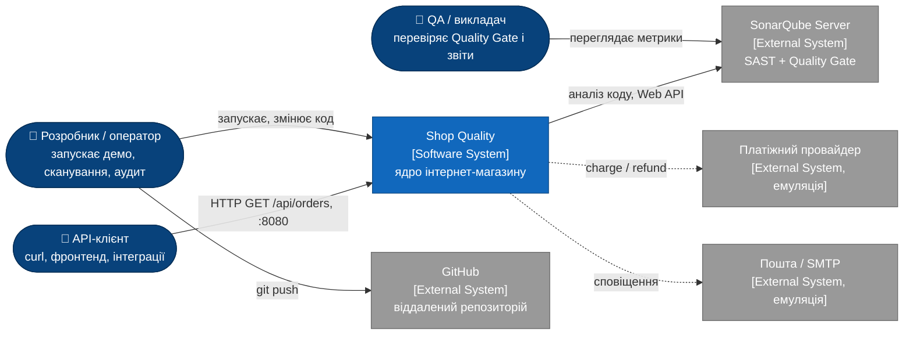
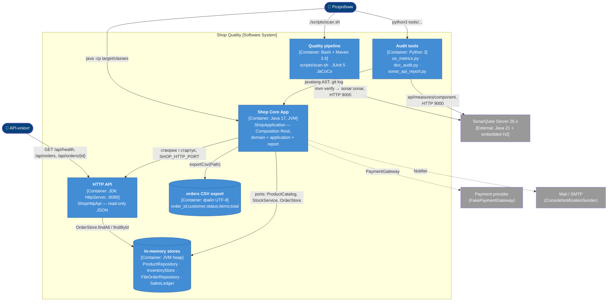
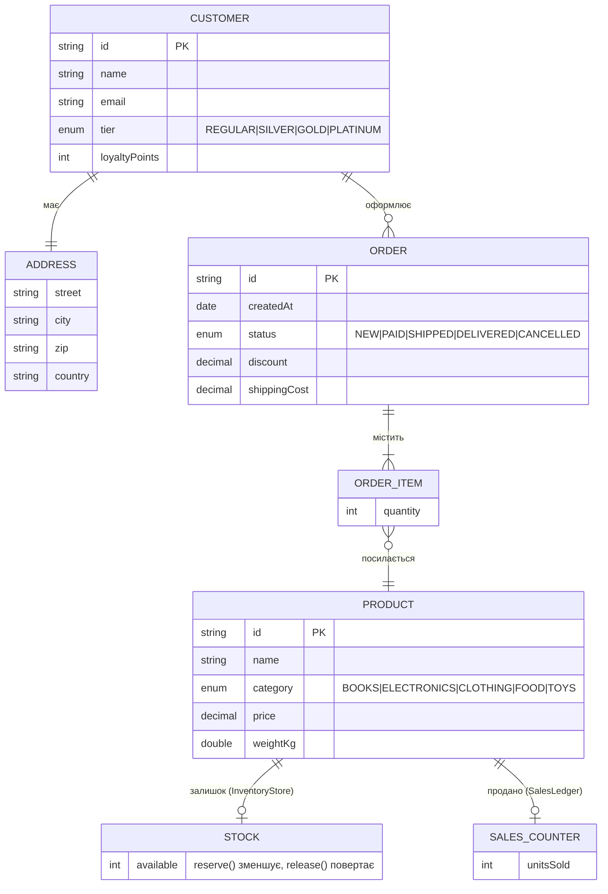

# SDD — System Design Document: Shop Quality

> **Як влаштована система всередині.** Де і на чому вона працює — [ISD](isd.md).
> Чому рішення саме такі — [ADR](adr/index.md). Регламент супроводу — [maintenance.md](../developer/maintenance.md).

## 1. Призначення та межі системи

**Shop Quality** — ядро інтернет-магазину (Java 17): каталог товарів, складські залишки, оформлення,
оплата, відвантаження і скасування замовлень, знижки за рівнем лояльності, звіти продажів, аналітика клієнта,
read-only HTTP API замовлень.
Система є навчальним об'єктом контролю якості: SonarQube Quality Gate (ЛР1), OO-аудит CK/MOOD (ЛР8),
аудит документації (ЛР10).

Поза межами системи: реальний платіжний провайдер, реальна пошта, персистентна БД. Їх емулюють адаптери
`FakePaymentGateway` і `ConsoleNotificationSender`, а дані зберігаються в пам'яті JVM (див. [ADR-0002](adr/0002-in-memory-storage-with-csv-export.md)).

## 2. C4 Level 1 — контекст

## 3. C4 Level 2 — контейнери

## 4. Компоненти (C4 Level 3)

Шари (див. [ADR-0001](adr/0001-hexagonal-ports-and-adapters.md)): `domain/` ← `application/` →
`application/port/` ← `infrastructure/`. Залежності спрямовані **до абстракцій**: сервіси знають лише порти,
конкретні адаптери підставляє тільки `ShopApplication`.

### 4.1 Пакети

| Пакет | Відповідальність | Взаємодіє з | Розгортання |
|---|---|---|---|
| `domain/` | Сутності та бізнес-правила: `Order`, `OrderItem`, `Product`, `Customer`, `Address`, enum `Category`, `CustomerTier`, `OrderStatus` | ні від чого не залежить | [ISD D1](isd.md#d1) |
| `application/` | Use-case сервіси (див. 4.2) | `domain/`, `application/port/`, `report/` | [ISD D1](isd.md#d1) |
| `application/port/` | Інтерфейси-контракти між use-case і адаптерами (розд. 6) | `domain/` | [ISD D1](isd.md#d1) |
| `infrastructure/` | Адаптери: сховища в пам'яті, платіжний шлюз, сповіщення (4.3) | реалізує `application/port/` | [ISD D1](isd.md#d1), [D2](isd.md#d2) |
| `report/` | Табличні звіти через композицію: `ReportTable` (final), `SalesReport`, `MonthlySalesReport` | `domain/` | [ISD D1](isd.md#d1) |
| `dto/` | `OrderDto` + `OrderMapper` — плоске представлення замовлення для CSV-експорту і HTTP API | `domain/`, `util/` | [ISD D1](isd.md#d1) |
| `api/` | `ShopHttpApi` — read-only HTTP API замовлень (розд. 4.4, контракт — 6.2) | `application/port/` (`OrderStore`), `dto/` | [ISD D1](isd.md#d1) |
| `util/` | `MoneyUtils` (округлення HALF_UP до 0.01), `CsvUtils` (роздільник `;`, лапки для значень з `;`, `"` або переносом рядка) | — | [ISD D1](isd.md#d1) |

### 4.2 Use-case сервіси (`application/`)

| Сервіс | Відповідальність | Залежить від портів |
|---|---|---|
| `CatalogService` | реєстрація товару, поповнення, наявність, звіт низьких залишків | `ProductCatalog`, `StockService` |
| `OrderPlacementService` | `placeOrder(customer, cart)` — алокація складу, ціна, знижка, доставка, збереження, лист | `ProductCatalog`, `StockReservation`, `PricingPolicy`, `OrderStore`, `Notifier` |
| `OrderPaymentService` | `pay(orderId)` / `refund(orderId)`, статистика продажів | `OrderStore`, `PaymentGateway`, `SalesStatistics`, `Notifier` |
| `OrderShippingService` | `ship` / `deliver` зі зміною статусу | `OrderStore`, `Notifier` |
| `OrderCancellationService` | `cancel(orderId)` — повернення складу і коштів | `OrderStore`, `StockReservation`, `PaymentProcessor`, `Notifier` |
| `PricingService` | знижка за `CustomerTier`, доставка (безкоштовно від 2000 грн) | реалізує `PricingPolicy` |
| `StockAllocator` | правила резервування (GOLD/PLATINUM отримують залишок) | реалізує `StockReservation`, використовує `StockService` |
| `SalesLedger` | облік проданих одиниць, `top(n)` | реалізує `SalesStatistics` |
| `SalesReportingService` | місячний звіт, рядки експорту | `OrderStore`, `report/` |
| `CustomerInsightsService` | резюме покупок клієнта, рекомендація рівня | `OrderStore` |
| `PromotionService` | розсилка акцій по категорії | `ProductCatalog`, `Notifier` |

### 4.3 Адаптери (`infrastructure/`)

| Компонент | Реалізує порт | Сховище / зовнішня система | Розгортання |
|---|---|---|---|
| `ProductRepository` | `ProductCatalog` | `LinkedHashMap` у JVM heap | [ISD D2](isd.md#d2) |
| `InventoryStore` | `StockService` | залишки й резерви в JVM heap | [ISD D2](isd.md#d2) |
| `FileOrderRepository` | `OrderStore` | замовлення в JVM heap + `exportCsv(Path)` у файл (назва історична, див. ADR-0002) | [ISD D2](isd.md#d2) |
| `FakePaymentGateway` | `PaymentGateway` | емуляція провайдера: ліміт 50 000 грн на транзакцію, `TX-n` | [ISD D1](isd.md#d1) |
| `ConsoleNotificationSender` | `Notifier` | лог `java.util.logging` + журнал `getSent()` для тестів | [ISD D1](isd.md#d1) |

### 4.4 HTTP API (`api/`)

| Компонент | Відповідальність | Залежить від | Розгортання |
|---|---|---|---|
| `ShopHttpApi` | вбудований `com.sun.net.httpserver.HttpServer` JDK; маршрути `/api/health`, `/api/orders`, `/api/orders/{id}`; серіалізація `OrderDto` у JSON; лише GET (інакше 405) | порт `OrderStore` (не знає конкретного сховища), `OrderMapper` | [ISD D1](isd.md#d1) — порт `SHOP_HTTP_PORT`, за замовч. 8080 |

Вибір вбудованого сервера замість Spring Boot — [ADR-0003](adr/0003-embedded-jdk-http-server.md).

**Composition Root** — `ShopApplication.main`: створює адаптери, підставляє їх у конструктори сервісів,
виконує демо-сценарій (2 товари → замовлення GOLD-клієнта → оплата → місячний звіт), потім **створює `ShopHttpApi`
над тим самим `OrderStore`, стартує його і залишається працювати** до `Ctrl+C` (shutdown hook зупиняє сервер).

## 5. Модель даних

Життєвий цикл замовлення: `NEW → PAID → SHIPPED → DELIVERED`; `NEW|PAID → CANCELLED` (відвантажене скасувати не можна — `IllegalStateException`). Змінювати позиції, знижку і доставку можна лише в статусі `NEW`.
Формат CSV-експорту (`FileOrderRepository.exportCsv`): заголовок `order_id;customer;status;items;total`,
роздільник `;`, суми — `BigDecimal` з 2 знаками.

## 6. Контракти між компонентами

### 6.1 API портів (внутрішні контракти)

| Порт | Операції | Постачальник → споживач |
|---|---|---|
| `ProductCatalog` | `save(Product)`, `findById(id): Optional`, `findAll()`, `findByCategory(c)`, `require(id)` → `IllegalArgumentException` | `ProductRepository` → Catalog/Placement/Promotion |
| `StockService` | `getStock(p)`, `add(p,q)`, `reserve(p,q)`, `release(p,q)` | `InventoryStore` → `CatalogService`, `StockAllocator` |
| `StockReservation` | `allocate(customer, product, requested): int`, `reserve(order)`, `release(order)` | `StockAllocator` → Placement/Cancellation |
| `OrderStore` | `save(order)`, `findById(id)`, `findAll()`, `require(id)` | `FileOrderRepository` → усі order-сервіси |
| `PricingPolicy` | `discountFor(order)`, `shippingFor(order)` | `PricingService` → Placement |
| `PaymentGateway` | `charge(customerId, amount): PaymentResult`, `refund(txId): boolean` | `FakePaymentGateway` → `OrderPaymentService` |
| `PaymentProcessor` | `pay(orderId): boolean`, `refund(orderId)` | `OrderPaymentService` → `OrderCancellationService` |
| `SalesStatistics` | `record(order)`, `revert(order)`, `top(limit): Map` | `SalesLedger` → `OrderPaymentService` |
| `Notifier` | `send(email, subject, body)` | `ConsoleNotificationSender` → усі сервіси зі сповіщеннями |

### 6.2 HTTP API (зовнішній контракт, `ShopHttpApi`)

| Запит | Статус | Тіло відповіді (`application/json; charset=utf-8`) |
|---|---|---|
| `GET /api/health` | 200 | `{"status":"UP"}` |
| `GET /api/orders` | 200 | масив `Order` (порожній — `[]`) |
| `GET /api/orders/{id}` | 200 / 404 | `Order` / `{"error":"Order not found","orderId":"{id}"}` |
| `POST`/`PUT`/`DELETE` `/api/orders…` | 405 | `{"error":"Method not allowed"}` |

Схема `Order`: `orderId` string · `customer` string · `status` enum `NEW|PAID|SHIPPED|DELIVERED|CANCELLED` ·
`items` int (сумарна кількість одиниць) · `total` string-десяткове з 2 знаками (щоб не втрачати точність `BigDecimal`).

Поведінкові контракти для QA перевіряються тестами `src/test/java`: `OrderTest` (розрахунок суми, статуси),
`ShopServicesTest` (use-case сценарії, відмова оплати > 50 000), `ReportTest` (рендер звітів),
`ShopHttpApiTest` (маршрути, коди 200/404/405, JSON-поля).

## 7. Якісні атрибути та обмеження

- **Підтримуваність:** CBO ≤ 8, LCOM-HS = 0, DIT ≤ 1 (контроль `scripts/oo-gate-*.sh`, ЛР8); Quality Gate
  «Shop-Quality-Gate»: 0 нових багів, 100 % hotspots reviewed, дублювання ≤ 3 %, Maintainability A.
- **Надійність даних:** дані живуть лише в пам'яті процесу — RPO/RTO див. [ISD §6](isd.md#d6-backup).
- **Без зовнішніх runtime-залежностей:** лише JDK (включно з модулем `jdk.httpserver`); JUnit 5 — тільки для тестів.
- **Безпека API:** лише читання, без автентифікації — призначене для локального демо; перед відкриттям назовні потрібен новий ADR.

## Пов'язані документи

[[isd]] · [[0001-hexagonal-ports-and-adapters|ADR-0001]] · [[0002-in-memory-storage-with-csv-export|ADR-0002]] · [[0003-embedded-jdk-http-server|ADR-0003]] · [[coding-standards]] · [[handover]]
