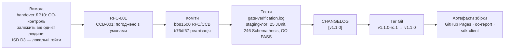

# Release Checklist (go / no-go)

Чек-лист заповнюється для кожного релізу; **будь-який ❌ = NO-GO**. Нижче — перший реліз за RFC-процесом.

## Реліз v1.1.0 (RFC-001)

| Поле | Значення |
|---|---|
| Версія / тег | `v1.1.0` (кандидат `v1.1.0-rc.1` = коміт `b76df67`) |
| Зміни | RFC-001 (OO-гейти в CI) + експлуатаційний пакет ЛР12 + виправлення API ЛР11 — [Історія змін](../changelog.md) |
| Дата go/no-go | 2026-11-22 18:58 UTC |
| Вікно | 19:00–19:30 UTC (погоджено CCB-001) |
| Рішення | **GO** |

| # | Критерій go/no-go | Статус | Доказ |
|---|---|---|---|
| 1 | Тести зелені: JUnit, контрактні (Schemathesis), OO-гейти | ✅ | 25/25 JUnit · 246/246 Schemathesis · OO GATE PASS ×2 ([staging-лог](https://github.com/YehorIshchuk/shop-quality/blob/main/docs/reports/lab12/release-v1.1.0-staging.log)) |
| 2 | Міграції перевірено на staging | ✅ | схеми БД немає (ADR-0002); контракт 1.0.0 без змін; кандидат розгорнуто на staging `deploy-api.sh v1.1.0-rc.1` (окремий `DEPLOY_DIR`, порт 18091), health UP за 2 с |
| 3 | Документація і CHANGELOG оновлені (DoD ЛР11) | ✅ | ISD D3, README, CONTRIBUTING у коміті реалізації; CHANGELOG `[v1.1.0]`; markdownlint 0 · strict-збірка Exit 0 · review audit 0 помилок · DOC CURRENCY GATE PASS |
| 4 | Моніторинг і алерти налаштовані | ✅ | [каталог A-01…A-04](../runbooks/alerts.md); `sli_probe --check` на staging: ALERT CONDITIONS OK (5xx 0 %, p95 13 мс) |
| 5 | Runbook відкату під руками | ✅ | [RB-001 §7](../runbooks/RB-001.md#7-відкат) (перевірено: відкат 2 с до health UP); відкат RFC — RFC-001 §4 |
| 6 | Бюджет помилок дозволяє реліз | ✅ | усі SLO — 0 % витрачено → нормальний режим ([slo.yaml](../slo.yaml)) |
| 7 | Комунікація підготовлена | ✅ | запис у CHANGELOG; повідомлення в README-бейджі конвеєра; для API-клієнтів змін немає |

## Ланцюг простежуваності релізу

## Пов'язані документи

[[RFC-001]] · [[CCB-001]] · [[RB-001]] · [[slo]]
