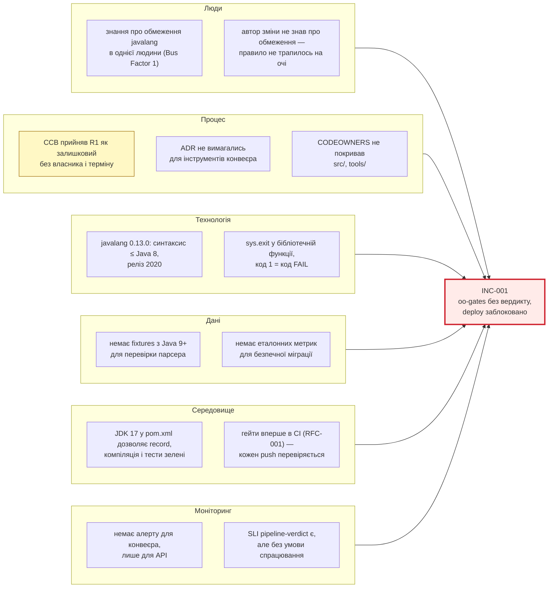

# PM-001 · Blameless Post-Mortem до INC-001

| Поле | Значення |
|---|---|
| Інцидент | [INC-001](INC-001.md) — job `oo-gates` без вердикту через legacy `tools/oo_metrics.py`, SEV-2 |
| Дата розбору | 2026-11-22 (UTC), позачергове засідання за [регламентом CCB](../changes/CCB-001.md#регламент-ccb) |
| Учасники (ролі) | архітектор, QA, SRE (черговий), Product Owner |
| Формат | **blameless**: шукаємо, яка умова в системі дозволила помилці статися, а не «хто винен» |

## 1. Принцип blameless

Автор коміту-тригера зробив **коректну** зміну: `record` — валідний синтаксис JDK 17, тести 25/25, DoD (SDD, CHANGELOG)
виконано. Питання не «чому розробник написав record», а «чому система дозволила коректному коду зупинити конвеєр,
і чому про обмеження дізнались лише з падіння». Імен у причинах немає — лише ролі, процеси й артефакти.

## 2. Короткий опис

19:09:09 UTC коміт `f966559` перевів `PaymentResult` на `record`. О 19:09:48 job `oo-gates` завершився кодом 1 з
`ERROR: cannot parse … javalang supports Java syntax up to Java 8`; `deploy` пропущено. API не постраждав. Виявлено
вручну за 19 с, тріаж ускладнило те, що код 1 збігається з кодом справжнього порушення CBO.

## 3. 5 Whys — аналіз першопричини

| # | Питання | Відповідь | Доказ |
|---|---|---|---|
| 1 | Чому конвеєр не видав вердикт і заблокував deploy? | `oo_metrics.py` аварійно завершився на `PaymentResult.java`, job `oo-gates` — FAILURE, `deploy` має `needs: oo-gates` | [лог відтворення](https://github.com/YehorIshchuk/shop-quality/blob/main/docs/reports/lab12/incident-INC-001-ci.log) рядок `ERROR: cannot parse … near line 4`; `docs.yml` `needs: [build, api-contract, oo-gates]` |
| 2 | Чому `oo_metrics.py` не зміг розібрати файл? | бібліотека `javalang 0.13.0` розбирає синтаксис лише до Java 8, а `record` — Java 16 | повідомлення самого інструмента (рядки 284–289 до CAPA); PyPI: останній реліз javalang — 2020-03-28; `pom.xml` — `maven.compiler.release 17` |
| 3 | Чому код із непідтримуваним синтаксисом дійшов до `main`, а не був зупинений раніше? | обмеження існувало лише **як речення** в coding-standards §4 — ніщо його не перевіряло автоматично; CODEOWNERS не покривав `src/` і `tools/`, тож review знавця обмеження не був обов'язковим | coding-standards §4 (версія до CAPA); `.github/CODEOWNERS` до CAPA — лише `/docs/`, `/.github/` тощо |
| 4 | Чому обмеження лишилося текстом, а не перевіркою чи рішенням? | в ЛР8 його обійшли разово (переписали switch-вирази) і не оформили як архітектурне рішення (ADR) з власником; знання трималося в голові однієї людини (Bus Factor = 1 для legacy-модуля) | кущ ADR містив 0001–0003, жодного про інструменти; аудит ЛР10 (handover, таблиця Bus Factor) — `oo_metrics.py` 🔴; [документація legacy](../legacy/oo-metrics.md) борг D-1 |
| 5 | Чому процес змін не змусив це оформити, коли гейти переносили в CI? | **регламент CCB дозволяв приймати ризик як «залишковий» без власника, терміну і тригера**, а процес ADR і тестування не поширювався на інструменти конвеєра — вони вважались «допоміжними скриптами», а не частиною продукту | [CCB-001](../changes/CCB-001.md) умова У5: «R1 приймається як залишковий… в беклог» — без власника і дати; ризик R1 в [RFC-001](../changes/RFC-001.md) (P2 × I3 = 6) пом'якшувався лише текстом; реєстр боргу T-1 «немає тестів» |

**Першопричина (процесна):** управління змінами розглядало інструменти конвеєра як другорядні: на них не
поширювались ADR, тести й обов'язковий review, а регламент CCB дозволяв залишковий ризик без власника.
Технічний збій javalang — **безпосередня причина**, а не корінь.

**Фактор, що посилив вплив:** однаковий код виходу 1 для «збій інструмента» і «порушено поріг» плюс відсутність
алерту для конвеєра (A-01…A-04 — лише API) → детекція вручну і зайвий крок тріажу.

## 4. Діаграма Ішікави

Жовтим виділено першопричину з 5 Whys (крок 5).

## 5. CAPA

**Коригувальна дія (corrective)** усуває причину **цього** інциденту, щоб саме він не повторився.
**Запобіжна дія (preventive)** усуває причину **потенційної** невідповідності, яка ще не сталася — тут: ті самі
слабкі місця в інших інструментах конвеєра і в майбутньому.

### CAPA-1 · Коригувальна · Розрізнити збій інструмента і вердикт

| Поле | Значення |
|---|---|
| ID | CAPA-1 |
| Тип | **corrective** — усуває фактор посилення (код 1 для двох різних станів, немає алерту) |
| Опис | `oo_metrics.py`: `sys.exit` у бібліотеці замінено на виняток `ParseFailure` з переліком **усіх** нерозбірних файлів; `main` повертає код **3** `OO TOOL ERROR`; модульні тести `tools/tests/` (fixtures Java 8 / record / Java 17) у job `oo-gates`; алерт **A-05** `OOGateToolError` (анотація GitHub) і runbook [RB-002](../runbooks/RB-002.md) |
| Власник | Yehor Ishchuk (L3, власник legacy-модуля) |
| Термін | 2026-11-22 |
| Статус | ✅ **Виконано** — коміт `docs(maintenance): deliver capa actions and swebok plan, PASS` |
| Перевірка ефективності | **критерій:** на коміті-тригері гейт дає код 3 і перелік файлів, а не 1. **Метод:** повтор тригера ([лог](https://github.com/YehorIshchuk/shop-quality/blob/main/docs/reports/lab12/capa-effectiveness-replay.log)) + тест `test_unparsable_source_is_tool_error_exit_3`. **Результат 2026-11-22:** ✅ `exit=3`, `OO TOOL ERROR … PaymentResult.java:4`. **Повторна перевірка 2026-12-22:** у запусках `docs.yml` за 30 днів немає падіння `oo-gates` без вердикту (код ≠ 0/1/3) |

### CAPA-2 · Коригувальна · Зробити обмеження синтаксису перевірюваним і мати власника ризику

| Поле | Значення |
|---|---|
| ID | CAPA-2 |
| Тип | **corrective** — усуває кроки 3–5 ланцюга (правило лише текстом, немає review, ризик без власника) |
| Опис | (а) `tools/java_syntax_guard.py` — крок CI перед гейтами і в `scripts/oo-audit.*`, вердикт з `file:line` і підказкою; (б) стабілізація: `PaymentResult` повернуто до `final`-класу; (в) coding-standards §4 посилається на guard і ADR-0004; (г) регламент CCB: залишковий ризик — лише з власником, терміном і тригером; (ґ) CODEOWNERS: `/tools/`, `/scripts/`, `/src/` |
| Власник | Yehor Ishchuk (архітектор — п. а–в, ґ; Change Manager / CCB — п. г) |
| Термін | 2026-11-22 |
| Статус | ✅ **Виконано** |
| Перевірка ефективності | **критерій:** повтор тригера зупиняється зрозумілим FAIL guard (exit 1) з назвою файлу й рядка ще до запуску javalang; у src немає конструкцій Java 9+. **Метод:** [лог повтору](https://github.com/YehorIshchuk/shop-quality/blob/main/docs/reports/lab12/capa-effectiveness-replay.log), тест `test_project_sources_pass_guard`, `test_guard_agrees_with_parser_on_fixtures`. **Результат 2026-11-22:** ✅ `JAVA SYNTAX GUARD: FAIL — … PaymentResult.java:4 [record]`; після стабілізації PASS, гейти PASS. **Наступне засідання CCB:** кожен прийнятий залишковий ризик має власника і дату |

### CAPA-3 · Запобіжна · Інструменти конвеєра як частина продукту

| Поле | Значення |
|---|---|
| ID | CAPA-3 |
| Тип | **preventive** — інциденту такого типу ще не було з іншими інструментами (mkdocs-плагіни, Spectral, Schemathesis), але умова та сама: застаріла залежність без власника і рішення |
| Опис | (а) [ADR-0004](../architecture/adr/0004-javalang-java8-syntax-limit.md): рішення щодо javalang з **планом міграції** на `tree-sitter-java` (еталонні метрики до 2027-01-31, парсер до 2027-02-28); (б) щотижневий плановий запуск `docs.yml` (`cron 17 6 * * 1`) — дрейф інструментів виявляється до того, як його знайде чийсь коміт; (в) реєстр інструментів конвеєра з власником і датою перегляду — [план супроводу §6](../maintenance-plan.md#6-пріоритети-вдосконалення-legacy) |
| Власник | Yehor Ishchuk |
| Термін | ADR і cron — 2026-11-22; міграція — **2027-02-28** |
| Статус | 🟡 **В роботі** — (а) рішення і (б) виконано; міграція парсера заплановано |
| Перевірка ефективності | **критерій 1:** 4 планові запуски поспіль (до 2026-12-22) завершились вердиктом, не збоєм інструмента. **Критерій 2 (2027-03-01):** fixture `tools/tests/fixtures/modern/Modern.java` (Java 17) розбирається новим парсером, метрики src збігаються з еталоном, ADR-0004 → Superseded. **Метод:** історія Actions (фільтр `event: schedule`), тести. **Результат:** очікується |

## 6. Що спрацювало добре

- `deploy` має `needs: oo-gates` — зламаний стан не потрапив на сайт; API-проби підтвердили нульовий вплив на клієнтів.
- Документація legacy-модуля, написана за годину до інциденту, дала готову гіпотезу (борг A-1) — тріаж 3 хв.
- Варіант «вимкнути job» відхилено: захист не знімали заради швидкості.

## 7. Уроки

1. Залишковий ризик без власника — це відкладений інцидент: R1 реалізувався в той самий день.
2. Правило, яке не перевіряє машина, не існує для нового учасника.
3. Код виходу — частина контракту інструмента; різні стани мусять мати різні коди.

## Пов'язані документи

[[INC-001]] · [[oo-metrics]] · [[RB-002]] · [[0004-javalang-java8-syntax-limit]] · [[maintenance-plan]] · [[CCB-001]]
