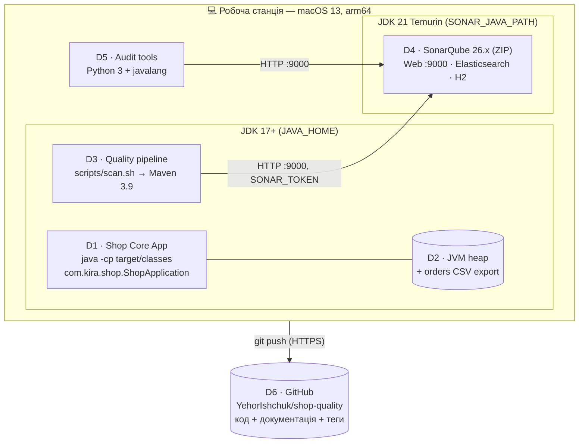
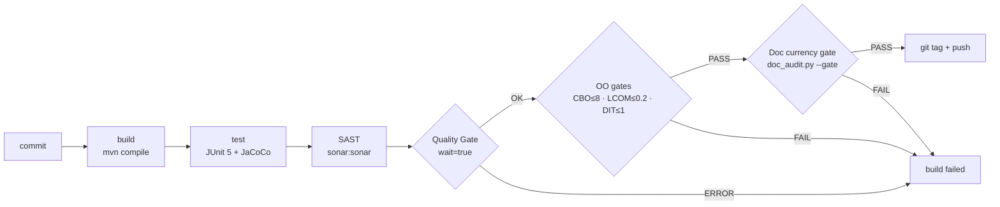

# ISD — Infrastructure Specification Document: Shop Quality

> **Де і на чому працює система.** Внутрішня структура — [SDD](sdd.md). Рішення — [ADR](architecture/adr/).
> Кожен компонент SDD посилається сюди на свій вузол розгортання `D1…D6`.

## 1. Топологія розгортання

Система розгортається **локально на робочій станції розробника**, без контейнерів і хмари:
MacBook Air (Apple Silicon, macOS 13), JDK 17+ для збірки та запуску, окремий JDK 21 для SonarQube.
`docker-compose.yml` залишено як **альтернативний** спосіб підняти SonarQube на Linux/Windows,
у робочому середовищі він не використовується (Docker Desktop недоступний).

**Порядок підняття сервісів:** (1) D4 SonarQube — `sonar.sh start`, дочекатися статусу `UP`;
(2) D3 — `scripts/scan.sh` (збирає D1 і відправляє аналіз у D4); (3) D1 запускається будь-коли після
`mvn verify`, від D4 не залежить; (4) D5 — після D3 (читає метрики з D4) або автономно (`oo_metrics.py`, `doc_audit.py`).

## 2. Середовища

| Середовище | Де | Призначення | Як потрапляє код | Критерій виходу |
|---|---|---|---|---|
| **dev** | IDE / VS Code на робочій станції | розробка, локальний запуск D1 | робоча копія | `mvn verify` зелений |
| **test** | та сама станція: Maven + SonarQube D4 | автотести, покриття JaCoCo, SAST, OO-гейти, doc-гейт | коміт у `main` | Quality Gate `OK`, `OO GATE: PASS`, `DOC CURRENCY GATE: PASS` |
| **production (demo)** | JVM на станції / ноутбук на захисті | демонстрація стану системи | git-тег (`lab*-pass`, `lab10-*`) з GitHub | демо-сценарій завершився з кодом 0 |

**Реліз** = анотований git-тег на `main` + `git push --tags`. **Відкат** = `git checkout <попередній тег>`
→ `mvn -B clean verify` → запуск D1 (≈ 2 хв). Стани FAIL з ЛР8 навмисно не компілюються — на них не відкочуємось.

## 3. Змінні середовища (без значень секретів)

| Змінна | Де використовується | Значення / приклад | Секрет |
|---|---|---|---|
| `SONAR_TOKEN` | `scripts/scan.sh`, `setup-quality-gate.sh`, `sonar-api-measures.sh`, `quality-gate-status.sh` | токен `squ_…` (My Account → Security) — лише в shell, **ніколи** не комітиться; `.env` у `.gitignore` | так |
| `SONAR_HOST_URL` | ті самі скрипти, `tools/sonar_api_report.py` | `http://localhost:9000` (за замовчуванням) | ні |
| `SONAR_JAVA_PATH` | запуск D4 `sonar.sh` | `/Library/Java/JavaVirtualMachines/temurin-21.jdk/Contents/Home/bin/java` | ні |
| `JAVA_HOME` | Maven, D1 | JDK 17+ (на станції — 21/22) | ні |
| `GATE_CLASSES` | `scripts/oo-gate-inheritance.sh` | список класів, за замовч. `ReportTable,SalesReport,MonthlySalesReport` | ні |

## 4. Вузли розгортання

### D1 · Shop Core App (JVM)
- Збірка: `mvn -B clean verify` → `target/classes`, звіт покриття `target/site/jacoco/jacoco.xml`.
- Запуск: `java -cp target/classes com.kira.shop.ShopApplication` — **одноразовий процес**: виконує демо-сценарій,
  друкує місячний звіт і резюме клієнта в лог (`java.util.logging`, stderr) і завершується з кодом 0.
- Мережевих портів не відкриває, зовнішніх runtime-залежностей немає (лише JDK).

### D2 · Сховища даних
- Каталог, залишки, замовлення, статистика — колекції в **JVM heap** процесу D1 (див. [ADR-0002](architecture/adr/0002-in-memory-storage-with-csv-export.md)).
- Персистентний артефакт — CSV-експорт замовлень `FileOrderRepository.exportCsv(Path)`, шлях задає викликач (UTF-8, `;`).
- Сховище SonarQube — вбудована H2 у `sonarqube-26.x/data/` (лише для навчального інстансу).

### D3 · CI/CD-конвеєр (локальний)

Хмарного CI немає. Конвеєр — Bash-скрипти, які запускаються вручну перед `git push` і на кожному стані-тегу.

| Стадія | Команда | Тригер | Quality Gate / критерій |
|---|---|---|---|
| build + test + coverage | `mvn -B clean verify` | кожен коміт (вручну) | усі тести зелені |
| SAST | `scripts/scan.sh` (`sonar:sonar`, `sonar.qualitygate.wait=true`) | перед push, на кожному тезі | «Shop-Quality-Gate»: new bugs = 0, new hotspots reviewed = 100 %, duplicated lines ≤ 3 %, Maintainability = A |
| OO-гейти (ЛР8) | `scripts/oo-gate-god-object.sh check`, `scripts/oo-gate-inheritance.sh check` | зміни в `application/`, `report/` | CBO ≤ 8, LCOM ≤ 0.2, DIT ≤ 1, NMO = 0 |
| Doc-гейт (ЛР10) | `python3 tools/doc_audit.py --gate` | кожна зміна коду (правило «зміна коду = зміна документації») | `DOC CURRENCY GATE: PASS` |
| реліз | `git tag -a <name> && git push --follow-tags` | стан лабораторної | усі гейти PASS |

### D4 · SonarQube Server 26.x (ZIP-дистрибутив)
- Каталог: `~/sonarqube-26.x`; старт: `export SONAR_JAVA_PATH=…temurin-21…/bin/java && ./bin/macosx-universal-64/sonar.sh start`.
- Вимоги: JDK 21 (на JDK 17 — `UnsupportedClassVersionError`), **≥ 23 ГБ вільного місця** (поріг disk watermark Elasticsearch),
  у macOS — Full Disk Access для Terminal, якщо дистрибутив у `~/Downloads`.
- Порт `9000`; логи `logs/sonar.log`, `logs/es.log`, `logs/web.log`; зупинка `sonar.sh stop`.
- Налаштування гейта відтворюється скриптом `scripts/setup-quality-gate.sh` (ідемпотентний).

### D5 · Audit tools (Python)
- `pip install -r tools/requirements.txt` (`javalang==0.13.0`), Python ≥ 3.9.
- `tools/oo_metrics.py` → `reports/oo/<stage>/`; `tools/sonar_api_report.py` → таблиці з Web API; `tools/doc_audit.py` → `reports/docs/`.

## 5. Моніторинг

| Що | Інструмент | Цільове значення | Дія при відхиленні |
|---|---|---|---|
| Стан D4 | `curl -s localhost:9000/api/system/status` | `{"status":"UP"}` до 3 хв після старту | `logs/es.log` → вільне місце / версія Java |
| Якість коду | `scripts/quality-gate-status.sh` | `projectStatus.status = OK` | блок релізу, виправлення до PASS |
| Архітектура | `scripts/oo-gate-*.sh check` | `OO GATE: PASS` | рефакторинг до PASS |
| Актуальність документації | `tools/doc_audit.py --gate` | `DOC CURRENCY GATE: PASS`, Behind = 0 | оновити документ у тому ж PR/коміті |
| Робота D1 | лог JUL у stderr | рядки звіту без `SEVERE`, код виходу 0 | розбір стек-трейсу, тест на регресію |

## 6. Резервне копіювання та відновлення (RTO / RPO)

| Актив | Резервна копія | RPO (допустима втрата) | RTO (час відновлення) | Процедура відновлення |
|---|---|---|---|---|
| Код, документація, теги | GitHub `YehorIshchuk/shop-quality` (D6) | ≤ 1 робочий день (push щонайменше раз на день роботи) | ≤ 15 хв | `git clone` → `mvn -B clean verify` |
| Дані замовлень/залишків (D2) | немає (in-memory за ADR-0002); ручний CSV-експорт | весь сеанс роботи процесу | ≈ 1 с (перезапуск D1, демо-дані засіваються заново) | перезапустити D1 |
| Історія аналізів SonarQube | копія `data/` при зупиненому D4 (необов'язково) | усі аналізи після останньої копії | ≤ 30 хв | перевстановити ZIP → `setup-quality-gate.sh` → пересканувати теги ([DEMO.md §2](DEMO.md)) |
| Токен `SONAR_TOKEN` | не зберігається | — | ≤ 2 хв | згенерувати новий у My Account → Security, старий — Revoke |
