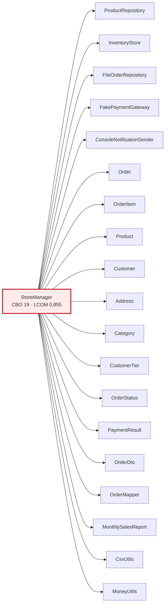

# Архітектурний Blueprint після декомпозиції God Object

## Було: `StoreManager` (CBO = 19, LCOM = 0.855, WMC = 67, 29 методів)

## Стало: use-case сервіси → порти (інтерфейси) ← адаптери інфраструктури

```mermaid
flowchart TB
    subgraph app[application — бізнес-логіка, кожен клас CBO ≤ 8, LCOM = 0]
        OPS[OrderPlacementService]
        OPay[OrderPaymentService]
        OShip[OrderShippingService]
        OCan[OrderCancellationService]
        Cat[CatalogService]
        Promo[PromotionService]
        Ins[CustomerInsightsService]
        Rep[SalesReportingService]
        Pr[PricingService]
        SA[StockAllocator]
        SL[SalesLedger]
    end
    subgraph port[application.port — контракти]
        PC([ProductCatalog])
        SS([StockService])
        OS([OrderStore])
        PG([PaymentGateway])
        N([Notifier])
        PP([PricingPolicy])
        SR([StockReservation])
        PPr([PaymentProcessor])
        ST([SalesStatistics])
    end
    subgraph infra[infrastructure — адаптери]
        PRepo[ProductRepository]
        Inv[InventoryStore]
        FOR[FileOrderRepository]
        FPG[FakePaymentGateway]
        CNS[ConsoleNotificationSender]
    end

    OPS --> PC & SR & PP & OS & N
    OPay --> OS & PG & ST & N
    OShip --> OS & N
    OCan --> OS & SR & PPr & N
    Cat --> PC & SS
    Promo --> PC & N
    Ins --> OS
    Rep --> OS

    Pr -. implements .-> PP
    SA -. implements .-> SR
    SA --> SS
    SL -. implements .-> ST
    OPay -. implements .-> PPr

    PRepo -. implements .-> PC
    Inv -. implements .-> SS
    FOR -. implements .-> OS
    FPG -. implements .-> PG
    CNS -. implements .-> N
```

Ключові властивості:
- жоден сервіс не посилається на інший сервіс чи на клас інфраструктури — лише на інтерфейси (DIP);
- усі залежності передаються через конструктор; конкретні реалізації зв'язуються в одному місці —
  Composition Root (`ShopApplication`, у тестах — `ShopFixture`);
- зміна контракту `InventoryStore` (FAIL-коміт) тепер зачіпає лише `StockService` і двох його
  клієнтів (`StockAllocator`, `CatalogService`) замість 7 місць у God Object.

| Клас | Відповідальність | CBO | LCOM | LCOM4 | WMC |
|---|---|---|---|---|---|
| OrderPlacementService | оформлення замовлення | 8 | 0.0 | 1 | 5 |
| OrderPaymentService | оплата / повернення | 7 | 0.0 | 1 | 6 |
| OrderShippingService | відвантаження / доставка | 3 | 0.0 | 1 | 3 |
| OrderCancellationService | скасування | 6 | 0.0 | 1 | 3 |
| CatalogService | реєстрація товарів, залишки | 3 | 0.0 | 1 | 6 |
| PromotionService | маркетингові розсилки | 5 | 0.0 | 1 | 3 |
| CustomerInsightsService | резюме клієнта, рекомендація рівня | 7 | 0.0 | 1 | 13 |
| SalesReportingService | місячний звіт, експорт | 5 | 0.0 | 1 | 3 |
| PricingService | знижки, доставка | 5 | 0.0 | 2 | 13 |
| StockAllocator | правила резервування | 7 | 0.0 | 1 | 13 |
| SalesLedger | статистика продажів | 3 | 0.0 | 1 | 6 |
