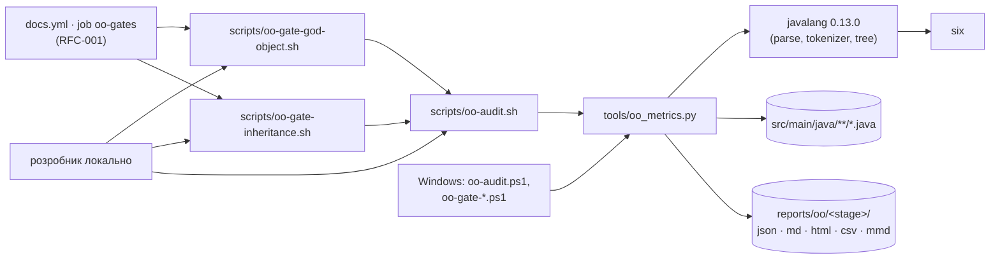

# Legacy-компонент `tools/oo_metrics.py` — відновлена документація

**Чому цей компонент.** Аудит ЛР10 (handover, таблиця Bus Factor) позначив його як найгірше задокументований із
найвищим ризиком 🔴: 683 рядки Python, 28 функцій, знання — лише в docstring і в голові автора, Bus Factor = 1.
Документ відновлено міні-реверс-інжинірингом 2026-11-22. Кожне твердження має рівень довіри:

- **verified** — перевірено інструментально (читання коду з номером рядка, запуск, вивід);
- **assumed** — гіпотеза, що потребує перевірки.

## 1. Призначення

Обчислює ООП-метрики Java-коду, яких сучасний SonarQube не дає: CK (WMC, CBO, Ca, RFC, LCOM-HS, LCOM4, DIT, NOC),
Lorenz-Kidd (NMO, NMA, PIM), MOOD (MHF, AHF, MIF, AIF, COF, PF), і виконує OO-гейт за порогами. **verified** — docstring
рядки 2–28, вивід запуску.

## 2. Граф залежностей

| Твердження | Довіра | Доказ |
|---|---|---|
| Викликається через `scripts/oo-audit.sh` (його кличуть два bash-гейти, CI-job `oo-gates` і розробник) **і напряму** з трьох PowerShell-скриптів `scripts/*.ps1` | verified | `grep -rn oo_metrics scripts .github` — 4 місця виклику (первісна гіпотеза «лише через oo-audit.sh» спростована) |
| Єдина стороння залежність — `javalang==0.13.0` (транзитивно `six`) | verified | `tools/requirements.txt`, `pip show javalang` |
| `javalang` 0.13.0 — останній реліз, **2020-03-28**; нових версій немає | verified | PyPI JSON API, історія релізів |
| `javalang` розбирає синтаксис Java лише до 8 (+ `var`): `record`, switch-вирази, text blocks — `JavaSyntaxError` | verified | рядки 284–289; повідомлення про помилку прямо це декларує |
| Інші компоненти системи (API, сервіси) від інструмента не залежать | verified | інструмент лише читає вихідні файли |

## 3. Формат вводу, виводу і конфігурації

**Ввід:** каталог з `.java` (рекурсивно), `--exclude` — імена класів (за замовч. `ShopApplication`). **verified** — рядки 277–282, 628–631.

**CLI:** `src`, `-o/--out`, `--exclude`, `--focus`, `--gate`, `--max-cbo` (8), `--max-lcom` (0.2), `--max-dit`, `--max-nmo`. **verified** — рядки 626–637.

**Вивід** у `reports/oo/<stage>/` (**verified** — запуск 2026-11-22, 43 класи):

| Файл | Вміст |
|---|---|
| `oo-metrics.json` | `{classes[], mood{}, generatedAt, source}`; клас: `class, kind, package, file, WMC, CBO, Ca, RFC, LCOM, LCOM4, DIT, NOC, NOM, NOF, NMO, NMA, PIM, overridden, maxCognitive, maxCognitiveMethod, couplesTo, usedBy, methods` |
| `oo-metrics.md` | таблиці CK і MOOD для звіту |
| `coupling-matrix.html` / `.csv` | матриця зв'язності (DSM) |
| `dependency-graph.mmd` | граф залежностей класів у Mermaid |

**Коди виходу:** `0` — гейт PASS або гейт не заданий; `1` — гейт FAIL **або** помилка розбору (`sys.exit(str)` у `parse_project`,
рядок 288). **verified** — рядки 288, 682. Дві різні ситуації дають **однаковий** код — див. борг C-2.

## 4. Ключові функції

| Функція | Призначення | Довіра |
|---|---|---|
| `parse_project` (277) | обхід файлів, `javalang.parse.parse`, побудова `TypeInfo`; при помилці розбору — **зупинка всього аналізу** | verified |
| `analyze_type` (325) | поля, методи, виклики, використані поля, посилання на типи проєкту | verified |
| `is_accessor` (309) | тривіальні `getX/isX/setX` з одним оператором — виключаються з LCOM | verified |
| `lcom_hs` (404) | LCOM\* Хендерсон-Селлерса: `(μ − m) / (1 − m)`, лише нестатичні методи без аксесорів | verified |
| `lcom4` (415) | число компонент зв'язності графа методів (union-find за викликами і спільними полями) | verified |
| `compute` (449), `mood` (508) | CK/Lorenz-Kidd і MOOD для всіх типів | verified (код); відповідність формул оригінальним статтям Абреу — **assumed** |
| `lcom4` збігається з історичним плагіном Sonar LCOM4 | — | **assumed** (заявлено в docstring, еталонного порівняння не було) |
| `main` (626) | розбір CLI, запис виводу, перевірка порогів, `OO GATE: PASS/FAIL` | verified |

## 4a. Реєстр технічного боргу і ризиків

| ID | Тип | Борг | Наслідки | Оцінка |
|---|---|---|---|---|
| A-1 | architecture | залежність від `javalang` — без релізів з 2020, синтаксис Java ≤ 8 | будь-який сучасний синтаксис (`record`, switch-вирази) **зупиняє гейт**, хоча код коректний; проєкт не може використовувати можливості власної версії Java 17 | 🔴 високий — **реалізувався: [INC-001](../incidents/INC-001.md)** |
| A-2 | architecture | 683 рядки в одному файлі: парсинг, метрики, звіти, гейт | зміна будь-якої частини ризикує зачепити інші; важко тестувати частинами | 🟠 середній |
| C-1 | code | `sys.exit()` усередині бібліотечної функції `parse_project` | один непарсований файл зупиняє аналіз усіх 43 класів; часткового звіту немає | 🟠 середній |
| C-2 | code | код виходу `1` означає і «гейт FAIL», і «інструмент упав» | CI і черговий не розрізняють порушення якості та збій інструмента → хибна діагностика, неможливо міряти SLI `pipeline-verdict` | 🔴 високий |
| T-1 | test | жодного автоматичного тесту для `tools/` | регресії інструмента виявляються лише в чужих збірках | 🔴 високий |
| T-2 | test | коректність метрик не звірялася з еталоном | помилка формули непомітна; рішення ЛР8 спираються на неперевірені числа | 🟡 нижче середнього |
| D-1 | documentation | формули й обмеження — лише в docstring; немає ADR щодо вибору парсера | обмеження Java ≤ 8 відоме лише автору; у [[coding-standards]] — один рядок без автоматичного контролю | 🔴 високий |
| D-2 | documentation | CCB-001 прийняв ризик R1 «як залишковий» без власника і терміну | ризик ніхто не відстежує | 🟠 середній |

## Пов'язані документи

[[INC-001]] · [[maintenance-plan]] · [[coding-standards]] · [[RFC-001]] · [[handover]]
