# Звіт ЛР11. Documentation as Code: база знань MkDocs, API-first (OpenAPI) і CI/CD документації

- **Студент:** Yehor Ishchuk
- **Об'єкт:** `shop-quality` з архітектурним паспортом ЛР10. Репозиторій: <https://github.com/YehorIshchuk/shop-quality>
- **Сайт документації (GitHub Pages):** **<https://yehorishchuk.github.io/shop-quality/>**
- **Інструменти:** MkDocs 1.6 + Material 9.8 (search, tags, roamlinks, include-markdown, mermaid2, swagger-ui-tag,
  git-revision-date-localized), Obsidian, OpenAPI 3.0.3, Spectral 6, Swagger UI, OpenAPI Generator 7.27,
  Schemathesis 4, markdownlint-cli2, GitHub Actions + Pages
- **Дата:** 2026-11-22

**Коміти ЛР11:**

| Коміт | Повідомлення | Завдання |
|---|---|---|
| `753c60c` | `docs(kb): build four-level knowledge base with MkDocs Material` | 1 |
| `820a435` | `docs(api): add OpenAPI contract, Spectral rules and Swagger UI reference` | 2 |
| `d451937` | `fix(api): align ShopHttpApi with the OpenAPI contract` | 2 (дрейф) |
| `7f2b482` | `ci(docs): add documentation pipeline with strict build and GitHub Pages deploy` | 3.1, 3.4 |
| `ba5ee95` (тег `lab11-ci-fail`) | `docs(ci): inject broken reference into strict build, FAIL` | 3.2 |
| `cfb81f4` (тег `lab11-ci-pass`) | `docs(ci): restore strict build pipeline, PASS` | 3.3 |
| наступний (тег `docs-v2.0`) | `docs(report): LAB11 report, docs-v2.0` | звіт |

---

## Завдання 1. DaC-скелет і корпоративна база знань

### 1.1 Чотирирівнева піраміда документації

```text
shop-quality/
├── README.md                    ← РІВЕНЬ 1 «що це і як запустити?» (5 хв): призначення, швидкий старт, карта бази знань, DoD
├── CHANGELOG.md                 ← історія змін (Keep a Changelog, теги docs-vX.Y)
├── mkdocs.yml                   ← конфігурація сайту: nav за рівнями, мова uk, плагіни, strict-валідація
├── requirements-docs.txt        ← зафіксовані версії MkDocs і плагінів
├── .markdownlint.yaml · .spectral.yaml
├── .github/
│   ├── CODEOWNERS               ← обов'язковий рев'ю власника для docs/, mkdocs.yml, конвеєрів
│   ├── pull_request_template.md ← чек-лист docs-or-don't-merge
│   └── workflows/docs.yml       ← CI/CD документації
├── tools/review_audit.py · doc_audit.py · doc-map.json
└── docs/
    ├── index.md                 ← рівень 1 на сайті: include README.md (SSOT, без копії)
    ├── developer/               ← РІВЕНЬ 2 «як приєднатися до розробки?»
    │   ├── CONTRIBUTING.md      (цикл зміни, front matter, Definition of Done, версії документації)
    │   ├── local-setup.md       (локальне середовище: код, MkDocs, SonarQube, Obsidian)
    │   ├── coding-standards.md  (стандарти ЛР1 + ЛР8)
    │   ├── maintenance.md       (регламент ЛР10)  ·  handover.md (ЛР10)
    ├── api/                     ← РІВЕНЬ 3 «як інтегруватися?»
    │   ├── openapi.yaml         (контракт — єдине джерело істини)
    │   ├── index.md             (Swagger UI, рендериться з openapi.yaml)
    │   └── reference.md         (SDK з контракту, Javadoc)
    ├── architecture/            ← РІВЕНЬ 4 «чому система влаштована саме так?»
    │   ├── sdd.md · isd.md      (паспорт ЛР10)
    │   ├── adr/                 (кущ ADR-0001…0003 + канон)
    │   └── blueprint-lab8.md    (deprecated → sdd.md)
    ├── changelog.md             ← include CHANGELOG.md
    ├── reports/                 ← архів документації процесу (звіти ЛР1/8/10/11, DEMO — deprecated)
    └── tags.md                  ← теги #architecture #api #ops #developer #process
```

**Без дублювання фактів:**

- README не копіюється на сайт, а включається (`include-markdown`);
- історія змін так само береться з `CHANGELOG.md`;
- таблиця REST-маршрутів, що дублювала контракт у SDD §6.2, замінена посиланням на `openapi.yaml`;
- деталі конвеєра якості переїхали з README на рівень 2 (`local-setup.md`).

### 1.2 Лістинг `mkdocs.yml`

```yaml
# База знань Shop Quality — Documentation as Code (ЛР11).
# Збірка: mkdocs build --strict   ·   Локально: mkdocs serve   ·   Публікація: .github/workflows/docs.yml
site_name: Shop Quality — база знань
site_description: Ядро інтернет-магазину на Java 17 — документація за пірамідою README → Developer → API → Architecture
site_author: Yehor Ishchuk
site_url: https://yehorishchuk.github.io/shop-quality/
repo_url: https://github.com/YehorIshchuk/shop-quality
repo_name: YehorIshchuk/shop-quality
edit_uri: edit/main/docs/
copyright: "© 2026 Yehor Ishchuk · Documentation as Code"

theme:
  name: material
  language: uk
  features:
    - navigation.sections   # рівні піраміди — окремі секції меню
    - navigation.indexes    # index.md секції = її оглядова сторінка
    - navigation.top
    - navigation.footer
    - search.highlight
    - content.code.copy
    - content.action.edit
  palette:
    - scheme: default
      primary: indigo
      toggle: {icon: material/brightness-7, name: Темна тема}
    - scheme: slate
      primary: indigo
      toggle: {icon: material/brightness-4, name: Світла тема}

# Strict-контроль (ЛР11, Завдання 3): кожне з цього списку — WARNING, а mkdocs build --strict
# перетворює будь-який WARNING на Exit Code 1 («не збирається — не їде»).
validation:
  omitted_files: warn        # orphan-сторінка: є в docs/, але немає в nav
  absolute_links: warn
  unrecognized_links: warn
  anchors: warn              # посилання на неіснуючий заголовок
  not_found: warn            # мертве посилання на неіснуючу сторінку

nav:
  - "1 · Що це і як запустити": index.md
  - "2 · Розробникам":
      - developer/index.md
      - developer/CONTRIBUTING.md
      - developer/local-setup.md
      - developer/coding-standards.md
      - developer/maintenance.md
      - developer/handover.md
  - "3 · API":
      - api/index.md
      - api/reference.md
  - "4 · Архітектура":
      - architecture/index.md
      - architecture/sdd.md
      - architecture/isd.md
      - "Кущ ADR":
          - architecture/adr/index.md
          - architecture/adr/0001-hexagonal-ports-and-adapters.md
          - architecture/adr/0002-in-memory-storage-with-csv-export.md
          - architecture/adr/0003-embedded-jdk-http-server.md
      - architecture/blueprint-lab8.md
  - "Історія змін": changelog.md
  - "Архів процесу":
      - reports/index.md
      - reports/LAB1_REPORT.md
      - reports/LAB8_REPORT.md
      - reports/LAB10_REPORT.md
      - reports/LAB11_REPORT.md
      - reports/DEMO.md
  - "Теги": tags.md

extra_css:
  - stylesheets/extra.css

extra:
  status:                          # front matter status → значок і підказка в навігації
    draft: Чернетка
    in-review: На рев'ю
    deprecated: Застаріла сторінка — див. актуальний документ

plugins:
  - search:
      lang: [ru, en]               # lunr не має українського стемера; ru дає найближчу морфологію
  - tags                           # front matter tags → сторінка «Теги» (ті самі теги бачить Obsidian)
  - roamlinks                      # wikilinks з Obsidian → звичайні посилання на сайті
  - include-markdown               # docs/index.md і changelog.md рендеряться з README.md / CHANGELOG.md (SSOT)
  - mermaid2                       # C4- і ER-діаграми з ЛР10
  - swagger-ui-tag                 # <swagger-ui src="openapi.yaml"/> — довідка API з контракту (SSOT)
  - git-revision-date-localized:   # дата останнього коміту сторінки — основа метрики актуальності
      type: date
      locale: uk
      enable_creation_date: true
      fallback_to_build_date: true
      strict: false                # нова ще не закомічена сторінка — не дефект документації

markdown_extensions:
  - admonition
  - attr_list
  - md_in_html
  - tables
  - toc:
      permalink: true
  - pymdownx.details
  - pymdownx.superfences:
      custom_fences:
        - name: mermaid
          class: mermaid
          format: !!python/name:mermaid2.fence_mermaid_custom
```

Під час міграції strict-збірка одразу показала **понад 30 мертвих посилань** (файли переїхали в `architecture/`,
`developer/`, `reports/`). Їх виправлено скриптом перерахунку відносних шляхів; посилання на файли поза `docs/`
(логи, скрипти) замінено на адреси GitHub.

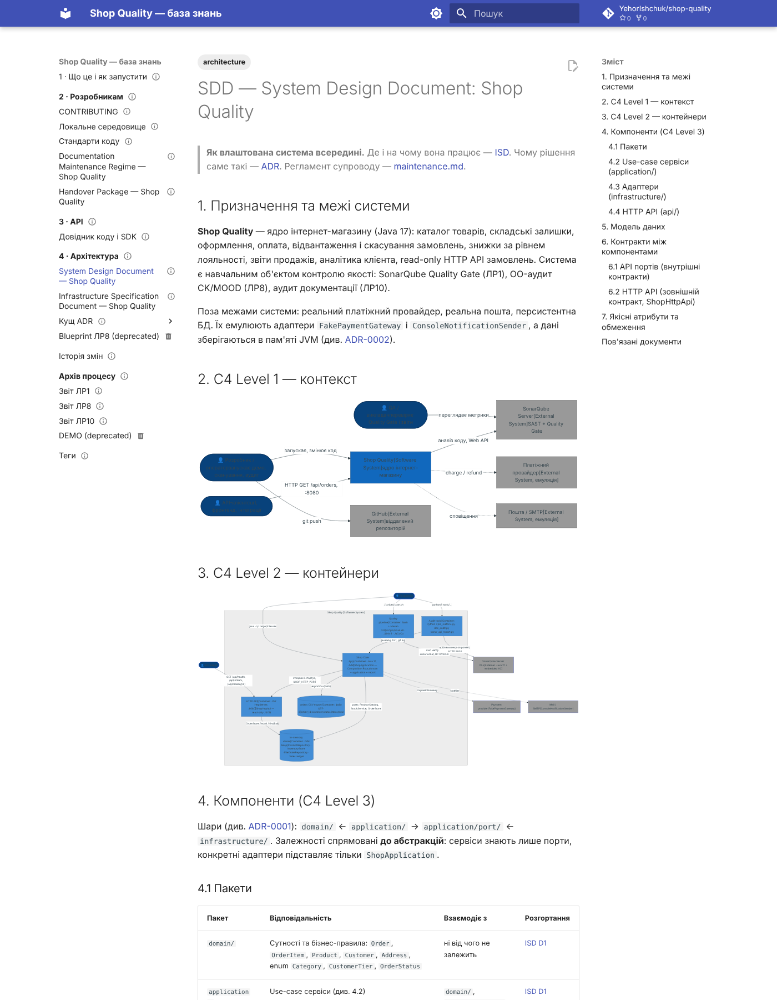

### 1.3 Front matter-паспорти

Паспорт є в усіх 25 сторінках (перевіряє `tools/review_audit.py`, див. 3.4). Приклади:

```yaml
# docs/architecture/sdd.md
title: SDD — System Design Document
owner: Yehor Ishchuk
status: published
review_date: 2027-05-20        # архітектурна: цикл 180 днів від аудиту ЛР10
tags: [architecture]
```

```yaml
# docs/architecture/adr/0003-embedded-jdk-http-server.md
title: "ADR-0003: HTTP API на JDK HttpServer"
owner: Yehor Ishchuk
status: published
review_date: 2027-05-20
adr: "0003"
decision: Accepted
tags: [architecture, api]
```

```yaml
# docs/reports/DEMO.md
title: DEMO (deprecated)
owner: Yehor Ishchuk
status: deprecated
review_date: 2026-11-21        # дата рішення про деприкацію (аудит ЛР10)
superseded_by: developer/local-setup.md
tags: [process, ops]
```

### 1.4 CODEOWNERS і кущ ADR

```text
# Власники документації (регламент docs/developer/maintenance.md).
# Разом із правилом гілки main «Require review from Code Owners» зміна цих шляхів
# фізично не зливається без схвалення власника.

/docs/                      @YehorIshchuk
/README.md                  @YehorIshchuk
/CHANGELOG.md               @YehorIshchuk
/mkdocs.yml                 @YehorIshchuk
/requirements-docs.txt      @YehorIshchuk
/.github/                   @YehorIshchuk
```

Фізичним бар'єром CODEOWNERS стає разом із правилом гілки: *Settings → Branches → Add rule* для `main` →
*Require a pull request before merging → Require review from Code Owners*. Тоді зміну `docs/` без схвалення
власника злити неможливо. У проєкті з одним власником GitHub не дає схвалити власний PR, тому правило вмикається
після здачі (адміністратор може його обійти). Для команди воно працює повністю.

| ADR | Рішення | Статус |
|---|---|---|
| ADR-0001 | порти та адаптери + ручний DI замість God Object | Accepted |
| ADR-0002 | сховище в пам'яті + CSV-експорт | Accepted |
| ADR-0003 | HTTP API на вбудованому `HttpServer` JDK | Accepted |

**Канон** (`docs/architecture/adr/index.md`):

- наскрізна нумерація без перевикористання номерів;
- життєвий цикл `Proposed → Accepted → Superseded by ADR-N`;
- незмінюваність: нове рішення — новий запис, у старому змінюється лише статус.

### 1.5 Граф знань Obsidian

Wikilinks у блоках «Пов'язані документи» з'єднують SDD ↔ ISD ↔ ADR ↔ Developer Docs ↔ API; теги задані полем `tags`
у front matter (`#architecture`, `#api`, `#ops`, `#developer`, `#process`). На сайті wikilinks перетворює плагін `roamlinks`.

Автоматична перевірка зв'язності (усі wikilinks і Markdown-посилання між сторінками):

```text
вузлів: 25 · ребер: 121 · компонент зв'язності: 1
architecture/sdd.md: 19 зв'язків · isd.md: 16 · ADR-0001: 10 · ADR-0002: 7 · ADR-0003: 9
```

Перший прогін знайшов один «острів» — службову сторінку `tags.md`; її з'єднано з рівнями бази знань.
На скріншоті центральний кущ зв'язний. Окремі точки по краях (`oo-metrics`, `ck-mood-report`, `01-baseline`…`04-restored-pass`)
— це автоматично згенеровані звіти з папки `reports/` (ЛР8, ЛР10), а не сторінки бази знань `docs/`.

> 📸 **СКРІНШОТ 1:** граф Obsidian (корінь репозиторію як Vault → Cmd+G), видно зв'язний кущ SDD / ISD / ADR.

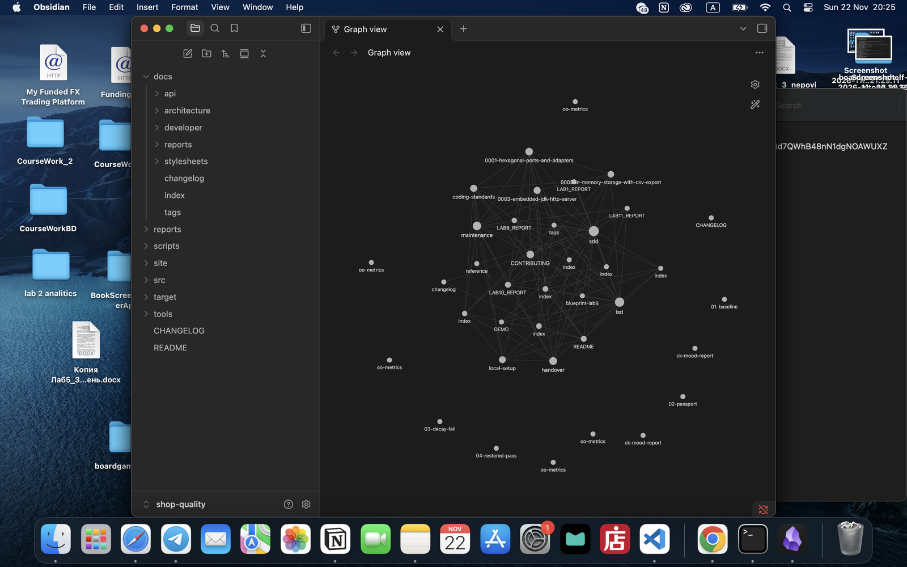

---

## Завдання 2. Контрактне документування API (API-first)

### 2.1 Лістинг `docs/api/openapi.yaml`

Контракт описує **реальні маршрути** `com.kira.shop.api.ShopHttpApi`, включно з ендпоінтами, доданими в краш-тесті ЛР10:

- `info.version: 1.0.0` за SemVer;
- 3 маршрути з описами операцій і прикладами;
- схеми `Health`, `Order` (`required`, `enum` статусів, `pattern` суми, `example`), `OrderList`;
- спільний `Error` для всіх 404 / 405 / 500 (405 — із заголовком `Allow`).

```yaml
openapi: 3.0.3
info:
  title: Shop Quality Orders API
  version: 1.0.0
  description: |
    Read-only HTTP API замовлень ядра інтернет-магазину Shop Quality.
    Реалізація — `com.kira.shop.api.ShopHttpApi` (вбудований `HttpServer` JDK, ADR-0003).
    Дані живуть у пам'яті процесу (ADR-0002): після перезапуску в системі одне демо-замовлення `ORD-1`.

    Контракт — єдине джерело істини (Single Source of Truth): з нього рендериться довідка Swagger UI
    у базі знань, генерується клієнтський SDK, а Schemathesis перевіряє живий API на відповідність.
  contact:
    name: Yehor Ishchuk
    url: https://github.com/YehorIshchuk/shop-quality
  license:
    name: Educational use (KPI labs)
servers:
  - url: http://localhost:8080
    description: Локальний запуск (порт за замовчуванням, змінна SHOP_HTTP_PORT)
tags:
  - name: system
    description: Технічний стан сервісу
  - name: orders
    description: Перегляд замовлень
paths:
  /api/health:
    get:
      tags: [system]
      operationId: getHealth
      summary: Перевірка доступності
      description: >-
        Health-check для моніторингу і порядку запуску сервісів (ISD §1, §5).
        Повертає `UP`, якщо HTTP API прийняв з'єднання.
      responses:
        '200':
          description: Сервіс працює
          content:
            application/json:
              schema:
                $ref: '#/components/schemas/Health'
              example:
                status: UP
        '405':
          $ref: '#/components/responses/MethodNotAllowed'
        '500':
          $ref: '#/components/responses/InternalError'
  /api/orders:
    get:
      tags: [orders]
      operationId: listOrders
      summary: Список замовлень
      description: >-
        Повертає всі замовлення зі сховища `OrderStore` у порядку створення.
        Порожнє сховище — порожній масив `[]`.
      responses:
        '200':
          description: Масив замовлень
          content:
            application/json:
              schema:
                $ref: '#/components/schemas/OrderList'
              example:
                - orderId: ORD-1
                  customer: Kira
                  status: PAID
                  items: 4
                  total: '31573.50'
        '405':
          $ref: '#/components/responses/MethodNotAllowed'
        '500':
          $ref: '#/components/responses/InternalError'
  /api/orders/{orderId}:
    get:
      tags: [orders]
      operationId: getOrderById
      summary: Замовлення за ідентифікатором
      description: >-
        Повертає одне замовлення. Невідомий ідентифікатор — `404` зі спільним об'єктом `Error`,
        у якому поле `orderId` повторює запитаний ідентифікатор.
      parameters:
        - name: orderId
          in: path
          required: true
          description: Ідентифікатор замовлення у форматі `ORD-<n>`
          schema:
            type: string
            minLength: 1
            example: ORD-1
      responses:
        '200':
          description: Знайдене замовлення
          content:
            application/json:
              schema:
                $ref: '#/components/schemas/Order'
              example:
                orderId: ORD-1
                customer: Kira
                status: PAID
                items: 4
                total: '31573.50'
        '404':
          description: Замовлення не знайдено
          content:
            application/json:
              schema:
                $ref: '#/components/schemas/Error'
              example:
                error: Order not found
                orderId: ORD-9
        '405':
          $ref: '#/components/responses/MethodNotAllowed'
        '500':
          $ref: '#/components/responses/InternalError'
components:
  schemas:
    Health:
      type: object
      description: Стан сервісу
      required: [status]
      properties:
        status:
          type: string
          enum: [UP]
          description: Стан HTTP API
      additionalProperties: false
      example:
        status: UP
    Order:
      type: object
      description: Плоске представлення замовлення (`OrderDto`)
      required: [orderId, customer, status, items, total]
      properties:
        orderId:
          type: string
          description: Ідентифікатор замовлення
          example: ORD-1
        customer:
          type: string
          description: Ім'я клієнта
          example: Kira
        status:
          type: string
          description: Стан життєвого циклу (SDD §5)
          enum: [NEW, PAID, SHIPPED, DELIVERED, CANCELLED]
          example: PAID
        items:
          type: integer
          format: int32
          minimum: 0
          description: Сумарна кількість одиниць товару в замовленні
          example: 4
        total:
          type: string
          pattern: '^-?\d+\.\d{2}$'
          description: Сума до сплати, UAH — рядок, щоб не втрачати точність `BigDecimal`
          example: '31573.50'
      additionalProperties: false
      example:
        orderId: ORD-1
        customer: Kira
        status: PAID
        items: 4
        total: '31573.50'
    OrderList:
      type: array
      description: Список замовлень
      items:
        $ref: '#/components/schemas/Order'
      example:
        - orderId: ORD-1
          customer: Kira
          status: PAID
          items: 4
          total: '31573.50'
    Error:
      type: object
      description: Спільний об'єкт помилки для всіх маршрутів і всіх кодів 4xx / 5xx
      required: [error]
      properties:
        error:
          type: string
          description: Людиночитний опис помилки
          example: Order not found
        orderId:
          type: string
          description: Запитаний ідентифікатор (лише для 404 на `/api/orders/{orderId}`)
          example: ORD-9
      additionalProperties: false
      example:
        error: Order not found
        orderId: ORD-9
  responses:
    MethodNotAllowed:
      description: Метод не підтримується — API лише для читання
      headers:
        Allow:
          description: Дозволені методи
          schema:
            type: string
            example: GET
      content:
        application/json:
          schema:
            $ref: '#/components/schemas/Error'
          example:
            error: Method not allowed
    InternalError:
      description: Неочікувана помилка сервера
      content:
        application/json:
          schema:
            $ref: '#/components/schemas/Error'
          example:
            error: Internal server error
```

### 2.2 Swagger UI та SDK

Довідка Swagger UI вбудована в сторінку `docs/api/index.md` тегом `<swagger-ui src="openapi.yaml"/>`.

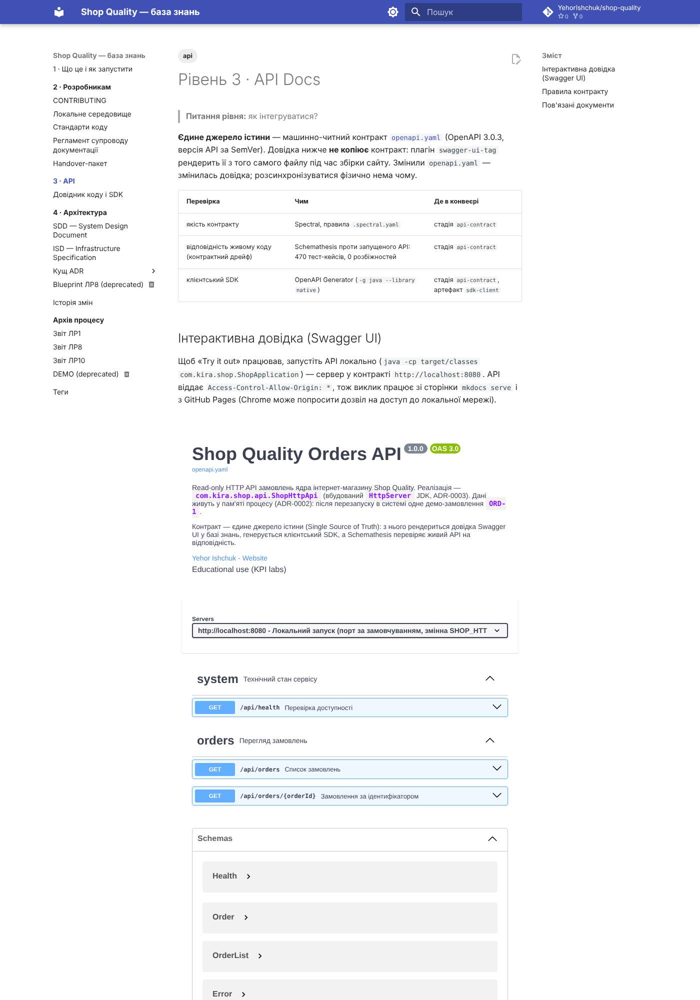

> 📸 **СКРІНШОТ 2:** Swagger UI → `GET /api/orders` → *Try it out* → *Execute*: Server response **200**, тіло з `ORD-1`,
> `content-type: application/json` (API і `mkdocs serve` запущено локально).

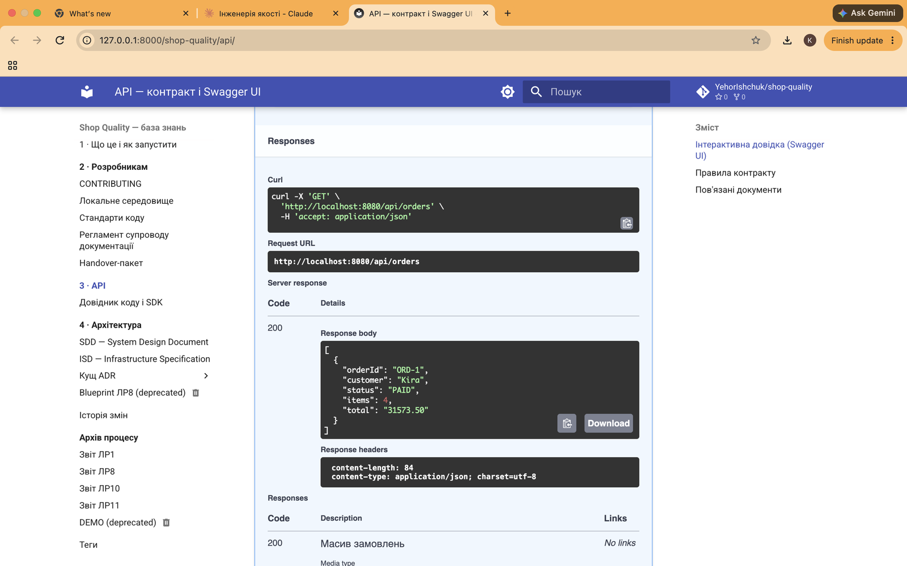

**Генерація SDK:**

```text
$ openapi-generator-cli generate -i docs/api/openapi.yaml -g java --library native -o sdk-client \
    --additional-properties=groupId=com.kira.shop,artifactId=shop-orders-client,artifactVersion=1.0.0,...
# OpenAPI Generator 7.27.0 → 46 файлів, Maven-проєкт com.kira.shop:shop-orders-client:1.0.0
src/main/java/com/kira/shop/client/api/OrdersApi.java   → List<Order> listOrders(); Order getOrderById(String)
src/main/java/com/kira/shop/client/api/SystemApi.java   → Health getHealth()
src/main/java/com/kira/shop/client/model/{Order,Health,Error}.java
```

Повний лог: [`sdk-generation.log`](https://github.com/YehorIshchuk/shop-quality/blob/main/docs/reports/lab11/sdk-generation.log).
У конвеєрі SDK генерується заново, **компілюється** (`mvn package`) і публікується як артефакт `sdk-client`.

### 2.3 Лінтинг Spectral

Правила `.spectral.yaml`:

- `spectral:oas` recommended;
- піднято до error: `operation-description`, `operation-operationId`, `operation-tags`;
- власні правила: `schema-has-example`, `operation-defines-500`, `error-responses-use-error-schema`,
  `error-responses-have-example`.

```text
$ spectral lint docs/api/openapi.yaml --fail-severity=error
No results with a severity of 'error' found!          → 0 errors, 0 warnings
```

Щоб переконатися, що власні правила не «порожні», контракт тимчасово зламано трьома способами:

- прибрано `example` у схемі;
- залишено порожній `description` операції;
- 404 переведено на схему `Order` замість `Error`.

Spectral видав 4 errors, тобто правила спрацьовують.

### 2.4 Single Source of Truth і контрактний дрейф

- **Довідка не копіює контракт.** `swagger-ui-tag` під час збірки бере той самий `openapi.yaml`, що й Spectral,
  Schemathesis і OpenAPI Generator. У базі знань немає другого опису маршрутів: SDD §6.2 лише посилається на контракт.
  Версія `1.0.0` і формат відповідей у довідці фізично беруться з одного файлу.
- **Перевірка відповідності живому коду.** Schemathesis (фази examples, coverage, fuzzing, stateful; `--checks all`)
  запускався проти API, запущеного з того самого коміту.

| Прогін | Тест-кейсів | Результат |
|---|---|---|
| до виправлення (`820a435`) | 405 | **4 дефекти документації/коду** |
| після `fix(api)` (`d451937`) | 470 | **0 розбіжностей** |

Знайдені розбіжності (контракт правий — код виправлено, підхід API-first):

1. **ST109** `GET /api/orders/{orderId}`: id з керуючими символами (`%0A`, `%19`…) → тіло 404 — **невалідний JSON**
   (екранувалися лише `\` і `"`). Виправлено: екранування за RFC 8259.
2. **ST204** `TRACE /api/health` → `200`: health приймав будь-який метод, а контракт описує лише GET. Виправлено: `405`.
3. **ST204 ×2** `TRACE /api/orders…` → `405` **без заголовка `Allow`** (RFC 9110). Виправлено: `Allow: GET`.
4. Додатково, з контракту (код 500 описано, але не реалізовано): неочікуваний виняток обривав з'єднання → тепер `500`
   зі спільним `Error`.

Логи: [до](https://github.com/YehorIshchuk/shop-quality/blob/main/docs/reports/lab11/schemathesis-before-fix.log) ·
[після](https://github.com/YehorIshchuk/shop-quality/blob/main/docs/reports/lab11/schemathesis-after-fix.log).
У конвеєрі Schemathesis виконується на кожен push (job `api-contract`), тож дрейф більше не може пройти непомітно.

### 2.5 Варіативний пункт: Javadoc

API-проєкт на Java → статичний довідник з doc-коментарів: job `build` генерує `javadoc` у `site/javadoc`,
сторінка «Довідник коду і SDK» посилається на <https://yehorishchuk.github.io/shop-quality/javadoc/>.

> 📸 **СКРІНШОТ 3:** розділ «3 · API» на задеплоєному сайті (GitHub Pages).

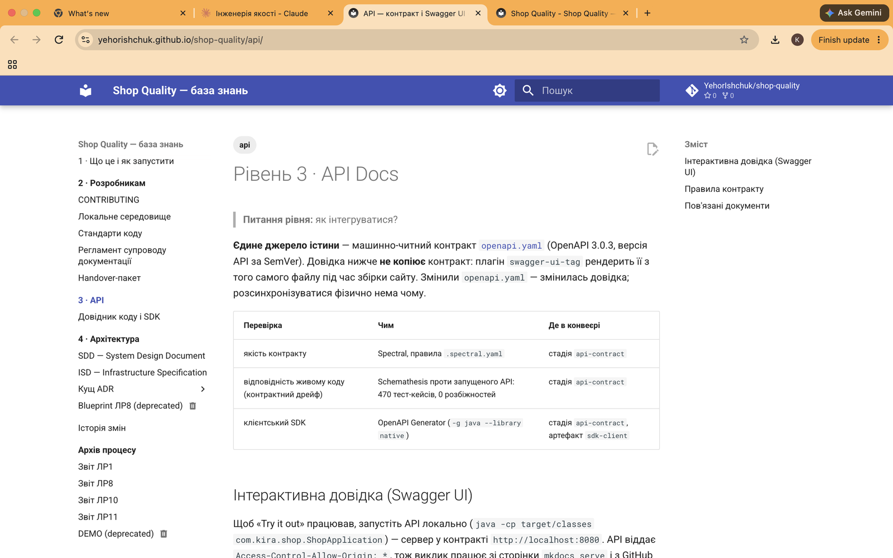

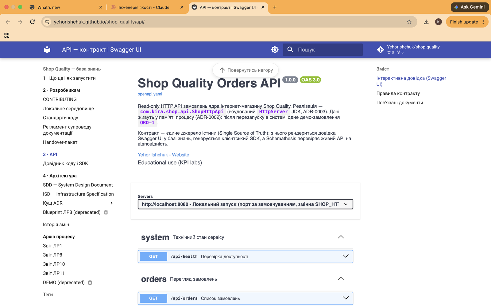

---

## Завдання 3. CI/CD-конвеєр документації: «не збирається — не їде»

### 3.1 Лістинг `.github/workflows/docs.yml`

```yaml
# Конвеєр документації Shop Quality (ЛР11, Завдання 3): «не збирається — не їде».
# Будь-який дефект документації (мертве посилання, сторінка поза nav, зламана розмітка,
# неякісний контракт, дрейф API від контракту, неповний паспорт) завершує job з Exit Code 1,
# а deploy на GitHub Pages виконується лише після зеленого build і api-contract.
name: docs

on:
  push:
    branches: [main]
  pull_request:
    branches: [main]
  workflow_dispatch:

permissions:
  contents: read

concurrency:                       # одна публікація за раз; новий push скасовує застарілу збірку
  group: docs-${{ github.ref }}
  cancel-in-progress: true

jobs:
  build:
    name: build (markdownlint → strict build)
    runs-on: ubuntu-latest
    steps:
      # 1. Checkout з повною історією: git-revision-date-localized бере дату останнього коміту кожної сторінки
      - uses: actions/checkout@v7
        with:
          fetch-depth: 0

      # 2. Python для MkDocs і скриптів аудиту
      - uses: actions/setup-python@v7
        with:
          python-version: "3.12"
          cache: pip
          cache-dependency-path: requirements-docs.txt

      # 3. mkdocs-material з плагінами (версії зафіксовано в requirements-docs.txt)
      - name: Install MkDocs Material and plugins
        run: pip install -r requirements-docs.txt

      # 4. Стиль Markdown — правила .markdownlint.yaml
      - name: markdownlint
        uses: DavidAnson/markdownlint-cli2-action@v25
        with:
          globs: |
            README.md
            CHANGELOG.md
            docs/**/*.md

      # 5. Паспорти документів: owner / status / review_date; прострочені review_date — у Summary і анотаціях
      - name: Review-date audit (front matter)
        run: python3 tools/review_audit.py

      # 6. Правило ЛР10 «зміна коду = зміна документації»
      - name: Doc currency gate (LR10)
        run: python3 tools/doc_audit.py --gate

      # 7. Strict-збірка: будь-який WARNING (мертве посилання, orphan-сторінка, битий якір) → Exit Code 1
      - name: mkdocs build --strict
        run: mkdocs build --strict

      # 8. Javadoc — статичний довідник з doc-коментарів коду (варіативний пункт), публікується як /javadoc/
      - uses: actions/setup-java@v6
        with:
          distribution: temurin
          java-version: "17"
      - name: Javadoc into site/javadoc
        run: >-
          javadoc -d site/javadoc -sourcepath src/main/java -subpackages com.kira.shop
          -encoding UTF-8 -docencoding UTF-8 -charset UTF-8 -Xdoclint:none -quiet
          -windowtitle "Shop Quality — Javadoc" -doctitle "Shop Quality — Javadoc"

      - name: Upload site artifact
        uses: actions/upload-pages-artifact@v5
        with:
          path: site

  api-contract:
    name: api-contract (Spectral → Schemathesis → SDK)
    runs-on: ubuntu-latest
    steps:
      - uses: actions/checkout@v7
      - uses: actions/setup-node@v7
        with:
          node-version: "22"

      # Якість контракту: правила .spectral.yaml, поріг — 0 errors
      - name: Spectral lint
        run: npx --yes @stoplight/spectral-cli@6 lint docs/api/openapi.yaml --fail-severity=error

      - uses: actions/setup-java@v6
        with:
          distribution: temurin
          java-version: "17"
          cache: maven
      - uses: actions/setup-python@v7
        with:
          python-version: "3.12"

      # Контрактний дрейф: Schemathesis проти живого API, зібраного з цього ж коміту
      - name: Build and start the API
        run: |
          mvn -B -q -DskipTests package
          nohup java -cp target/classes com.kira.shop.ShopApplication > api.log 2>&1 &
          for i in $(seq 1 30); do curl -sf localhost:8080/api/health && break; sleep 1; done
      # Версії зафіксовано: ті самі, якими контракт перевірено локально (відтворюваний результат)
      - name: Install contract tooling
        run: pip install schemathesis==4.33.4 openapi-generator-cli==7.27.0
      - name: Schemathesis contract test
        run: schemathesis run docs/api/openapi.yaml --url http://localhost:8080 --checks all --max-examples 60

      # Клієнтський SDK з контракту: генерація + компіляція доводять, що контракт придатний для інтеграції
      - name: Generate and compile Java SDK
        run: |
          openapi-generator-cli generate -i docs/api/openapi.yaml -g java --library native \
            -o sdk-client --additional-properties=groupId=com.kira.shop,artifactId=shop-orders-client,artifactVersion=1.0.0,invokerPackage=com.kira.shop.client,apiPackage=com.kira.shop.client.api,modelPackage=com.kira.shop.client.model,hideGenerationTimestamp=true
          mvn -B -q -f sdk-client/pom.xml -Dmaven.test.skip=true package
      - uses: actions/upload-artifact@v7
        with:
          name: sdk-client
          path: sdk-client/target/*.jar

  deploy:
    name: deploy (GitHub Pages)
    needs: [build, api-contract]           # червоний build або api-contract → сайт не оновлюється
    if: github.event_name != 'pull_request' && github.ref == 'refs/heads/main'
    runs-on: ubuntu-latest
    permissions:
      pages: write
      id-token: write
    environment:
      name: github-pages
      url: ${{ steps.deployment.outputs.page_url }}
    steps:
      - id: deployment
        uses: actions/deploy-pages@v5
```

### 3.2 Протокол краш-тесту (FAIL)

Дефект: мертве посилання в `docs/developer/CONTRIBUTING.md` → `release-process.md` (сторінки не існує).
markdownlint дефекту не бачить (0 issues). Зупиняє лише strict-збірка:

```text
$ mkdocs build --strict
WARNING -  AutoLinksPlugin unable to find release-process.md in directory …/docs
WARNING -  Doc file 'developer/CONTRIBUTING.md' contains a link 'release-process.md', but the target
           'developer/release-process.md' is not found among documentation files.
Aborted with 2 warnings in strict mode!
Error: Process completed with exit code 1.
```

Job `build` червоний, job `deploy` пропущено (`needs: [build, api-contract]`), тож сайт лишився на попередній версії.

> 📸 **СКРІНШОТ 4:** червоний run «docs» для коміту `docs(ci): inject broken reference into strict build, FAIL`
> (крок `mkdocs build --strict`, текст помилки і *exit code 1*; deploy — *skipped*).

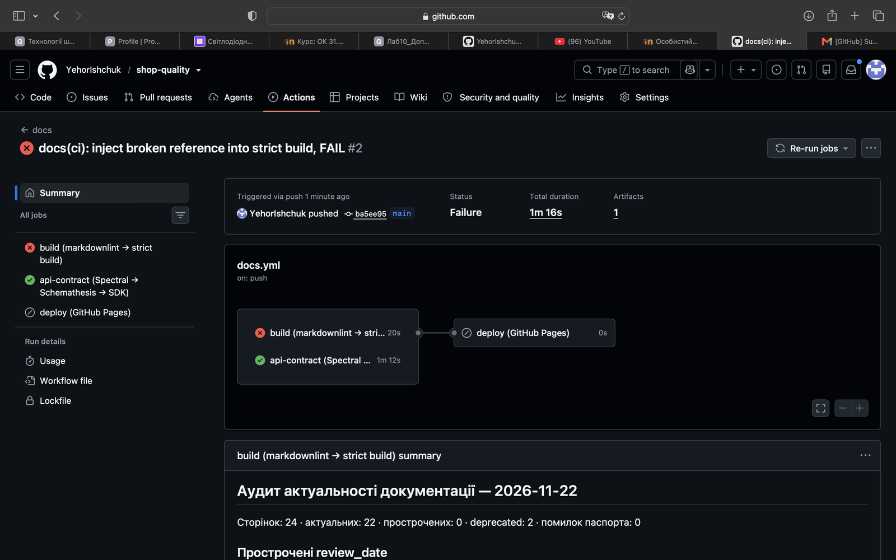

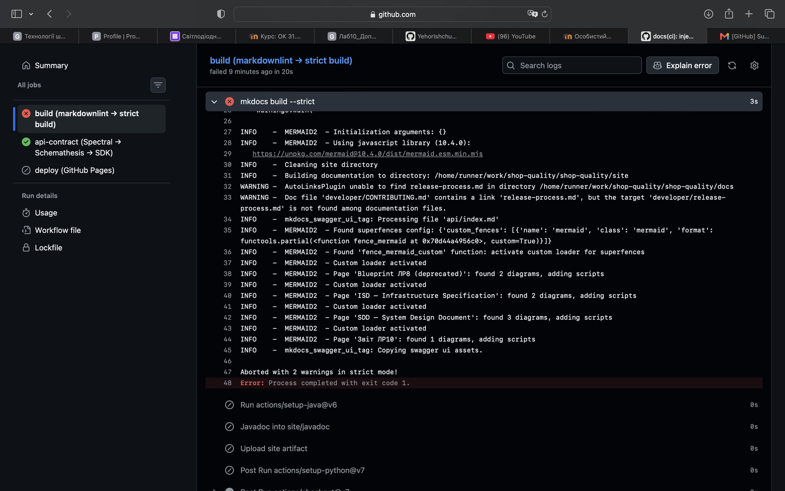

### 3.3 Протокол відновлення (PASS)

Посилання замінено на існуючий регламент (`maintenance.md`, пункти 5–6). markdownlint: 0 issues;
`mkdocs build --strict`: `Documentation built`, **exit code 0**. Deploy опублікував сайт; внизу кожної сторінки —
автоматична дата останнього редагування з Git (плагін `git-revision-date-localized`).

> 📸 **СКРІНШОТ 5:** зелений run «docs» (build ✅ · api-contract ✅ · deploy ✅).
>

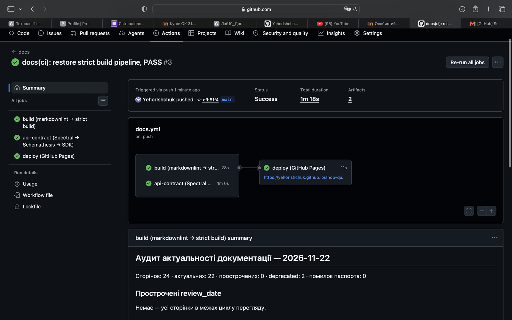

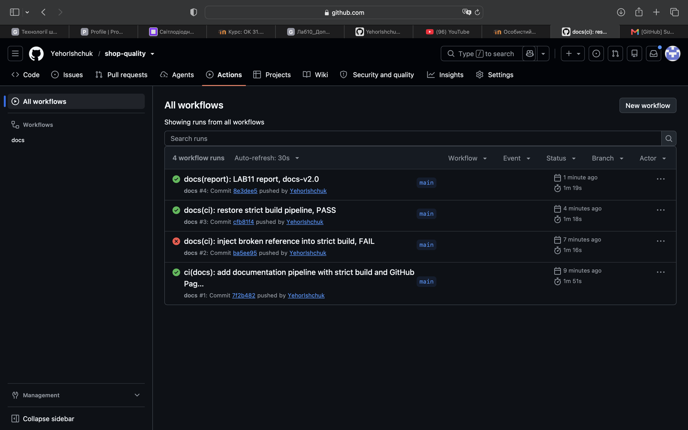
> 📸 **СКРІНШОТ 6:** задеплоєний сайт <https://yehorishchuk.github.io/shop-quality/> (видно адресу і дату редагування внизу сторінки).

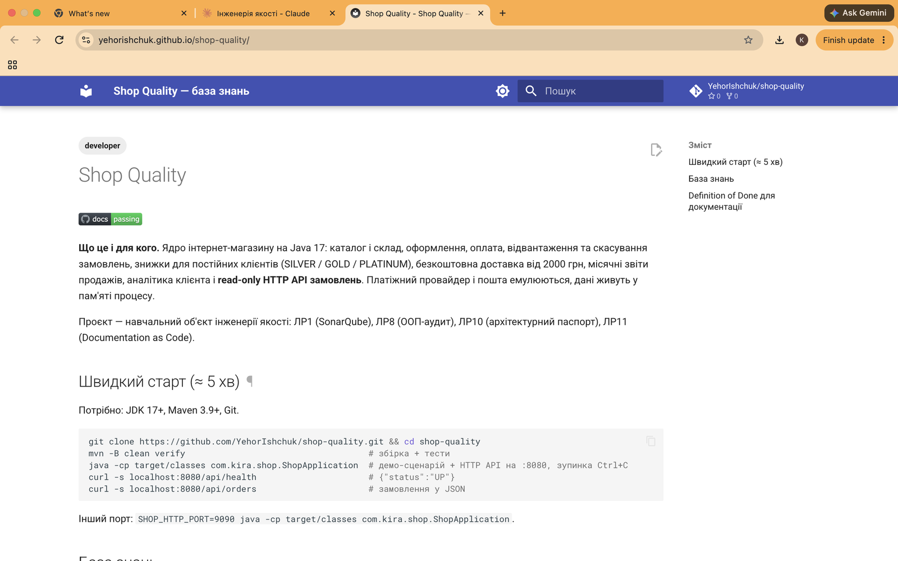

### 3.4 Безперервний супровід

**Definition of Done** — розділ «Definition of Done: docs-or-don't-merge» у
[CONTRIBUTING](../developer/CONTRIBUTING.md) і таблиця перевірок у README. PR, що змінює публічну поведінку,
не зливається без оновлення `docs/`, `openapi.yaml` (+ SemVer) і `CHANGELOG.md`.

**Автоматизований аудит `review_date`** — крок `Review-date audit` у кожному запуску конвеєра (вивід у *Summary* job):

```text
## Аудит актуальності документації — 2026-11-22

Сторінок: 24 · актуальних: 22 · прострочених: 0 · deprecated: 2 · помилок паспорта: 0

### Прострочені review_date

Немає — усі сторінки в межах циклу перегляду.

### Deprecated (переспрямування на актуальний документ)

| Сторінка | Власник | superseded_by | Дата рішення |
|---|---|---|---|
| `architecture/blueprint-lab8.md` | Yehor Ishchuk | `architecture/sdd.md` | 2026-11-21 |
| `reports/DEMO.md` | Yehor Ishchuk | `developer/local-setup.md` | 2026-11-21 |

### Найближчі перегляди

| Сторінка | Власник | review_date | Залишилось, дн |
|---|---|---|---|
| `api/index.md` | Yehor Ishchuk | 2027-02-19 | 89 |
| `api/reference.md` | Yehor Ishchuk | 2027-02-19 | 89 |
| `architecture/isd.md` | Yehor Ishchuk | 2027-02-19 | 89 |
| `changelog.md` | Yehor Ishchuk | 2027-02-19 | 89 |
| `developer/CONTRIBUTING.md` | Yehor Ishchuk | 2027-02-19 | 89 |
```

Прострочених сторінок на дату здачі немає: паспорти створено 2026-11-22, а цикли регламенту ЛР10 становлять
90 і 180 днів. Те, що механізм справді ловить прострочення, показує прогін на дату першого планового перегляду:

```text
$ python3 tools/review_audit.py --today 2027-03-01
### Прострочені review_date

| Сторінка | Власник | Статус | review_date | Прострочено, дн |
|---|---|---|---|---|
| `api/index.md` | Yehor Ishchuk | published | 2027-02-19 | 10 |
| `api/reference.md` | Yehor Ishchuk | published | 2027-02-19 | 10 |
| `architecture/isd.md` | Yehor Ishchuk | published | 2027-02-19 | 10 |
| `changelog.md` | Yehor Ishchuk | published | 2027-02-19 | 10 |
| `developer/CONTRIBUTING.md` | Yehor Ishchuk | published | 2027-02-19 | 10 |
| `developer/coding-standards.md` | Yehor Ishchuk | published | 2027-02-19 | 10 |
| `developer/handover.md` | Yehor Ishchuk | published | 2027-02-19 | 10 |
| `developer/index.md` | Yehor Ishchuk | published | 2027-02-19 | 10 |
| `developer/local-setup.md` | Yehor Ishchuk | published | 2027-02-19 | 10 |
| `developer/maintenance.md` | Yehor Ishchuk | published | 2027-02-19 | 10 |
| `index.md` | Yehor Ishchuk | published | 2027-02-19 | 10 |
| `tags.md` | Yehor Ishchuk | published | 2027-02-19 | 10 |

### Deprecated (переспрямування на актуальний документ)

| Сторінка | Власник | superseded_by | Дата рішення |
|---|---|---|---|
| `architecture/blueprint-lab8.md` | Yehor Ishchuk | `architecture/sdd.md` | 2026-11-21 |
| `reports/DEMO.md` | Yehor Ishchuk | `developer/local-setup.md` | 2026-11-21 |
```

**Деприкація замість видалення:**

- `reports/DEMO.md` і `architecture/blueprint-lab8.md` мають `status: deprecated`, `superseded_by` і банер
  із переспрямуванням на актуальний документ;
- у навігації сайту їх позначено значком «Застаріла сторінка»;
- аудит падає, якщо `superseded_by` вказує на неіснуючу сторінку.

**Версії документації** (анотовані теги):

| Тег | Коміт | Знімок |
|---|---|---|
| `docs-v1.0` | `fc8c69e` | архітектурний паспорт ЛР10 (SDD, ISD, ADR-0001…0003, регламент, handover) |
| `docs-v2.0` | коміт звіту ЛР11 | база знань MkDocs, OpenAPI-контракт, конвеєр документації |

Відновлення знімка: `git checkout docs-v1.0` (і `mkdocs serve` для v2.0+).

---

## Лог валідації ШІ-Техліда (протокол проходження краш-тесту)

**Декларація.** Роботу виконано в діалозі з ШІ-асистентом Claude (Anthropic). ШІ згенерував:

- структуру бази знань, `mkdocs.yml`;
- специфікацію `openapi.yaml`, правила Spectral, workflow `docs.yml`;
- скрипт `review_audit.py` і виправлення `ShopHttpApi`.

Коміти ШІ мають трейлер `Co-Authored-By: Claude`. Регламент ЛР11 передбачає −3 бали, якщо специфікацію OpenAPI
чи workflow згенерував ШІ замість студента. Тому студент особисто звірив контракт з кодом і живим API (таблиця нижче),
пройшов конвеєр FAIL → PASS на GitHub і має бути готовим пояснити кожен рядок контракту й кожну стадію workflow.

| # | Крок / твердження ШІ | Як перевірено | Результат |
|---|---|---|---|
| 1 | Після переїзду файлів «усі посилання робочі» | `mkdocs build --strict` | ❌ **30+ мертвих посилань** → виправлено скриптом перерахунку шляхів |
| 2 | Плагін `roamlinks` безпечний для Mermaid | перегляд попереджень збірки | ❌ Mermaid-фігури «subroutine» (подвійні квадратні дужки) у C4 сприймались як wikilinks → замінено на звичайні `["…"]` |
| 3 | markdownlint чистий | `markdownlint-cli2` | ❌ 123 порушення (MD025 через `title` у front matter, порожні рядки) → конфіг + `--fix` → 0 |
| 4 | Власні правила Spectral працюють | мутаційний тест контракту (3 поломки) | ✅ 4 errors на зламаному, 0 на чистому |
| 5 | «Контракт описує реальний код» | Schemathesis проти живого API | ❌ **4 розбіжності** (невалідний JSON, health на будь-який метод, 405 без `Allow`) → `fix(api)` → 470/470 |
| 6 | README з таблицею DoD можна комітити в Завданні 1 | звірка з наявними інструментами | ⚠️ документ описував неіснуючі перевірки (Decay) → таблицю перенесено в коміт конвеєра |
| 7 | FAIL-стан падає саме на strict-збірці | локальний прогін двох тегів | ✅ `lab11-ci-fail` → exit 1 (2 warnings), `lab11-ci-pass` → exit 0 |
| 8 | Перевірка strict «з `-q`» показує FAIL | прогін | ❌ **хибний PASS**: `-q` приглушує warnings до підрахунку → перевірку повторено без `-q` |
| 9 | Граф знань зв'язний | підрахунок компонент зв'язності | ⚠️ острів `tags.md` → з'єднано; 1 компонента |
| 10 | Тести після зміни API | JUnit (25/25) + ворота ЛР10 (`DOC CURRENCY GATE: PASS`) | ✅ |
| 11 | Workflow синтаксично валідний | `actionlint` | ✅ |
| 12 | Конвеєр червоніє / зеленіє на GitHub | запуски Actions #1–#4 (скріншоти 4–5) | ✅ #2 — build Failure (exit 1), deploy skipped; #1, #3, #4 — Success, deploy |
| 14 | «Try it out працює і з GitHub Pages» (сторінка API) | Execute на `yehorishchuk.github.io` | ❌ **Failed to fetch**: Chrome блокує запити публічного сайту до `localhost` (Local Network Access) → текст сторінки API виправлено: «Try it out» — через `mkdocs serve` |

| 13 | Згадки синтаксису wikilinks у тексті звіту й `local-setup.md` | strict-збірка | ❌ `roamlinks` обробляє подвійні дужки навіть в інлайн-коді → формулювання змінено |

**Висновок.** Вісім кроків ШІ (1, 2, 3, 5, 6, 8, 13, 14) без перевірки дали б хибний результат. Найважливіше — пункт 5:
«впевнено» написаний контракт розходився з кодом у 4 місцях. Це й доводить, навіщо потрібен принцип «довідка
рендериться з контракту, а контракт перевіряється проти живого API».

## Пов'язані документи

[[CONTRIBUTING]] · [[maintenance]] · [[sdd]] · [[isd]]
